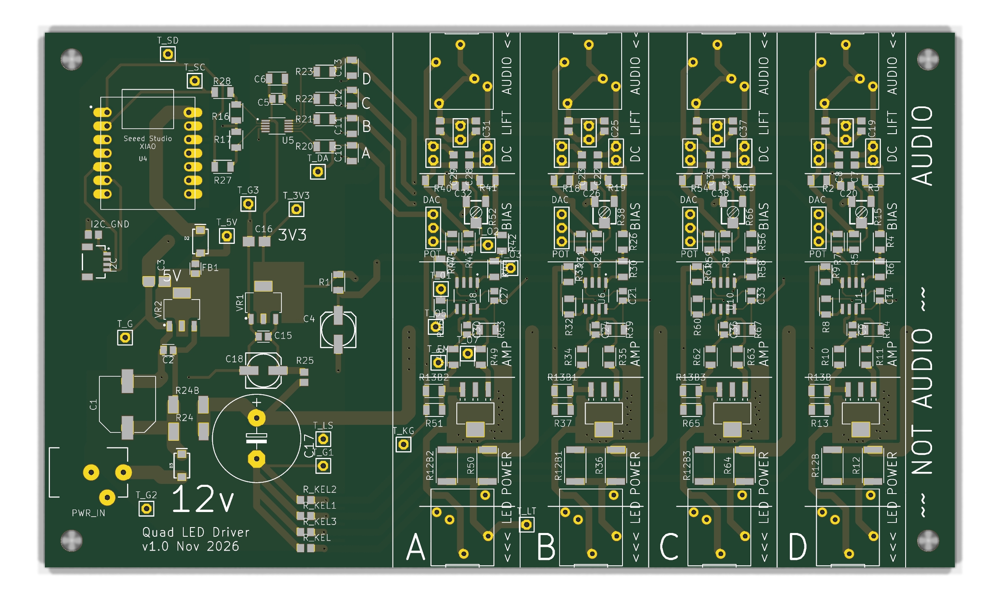
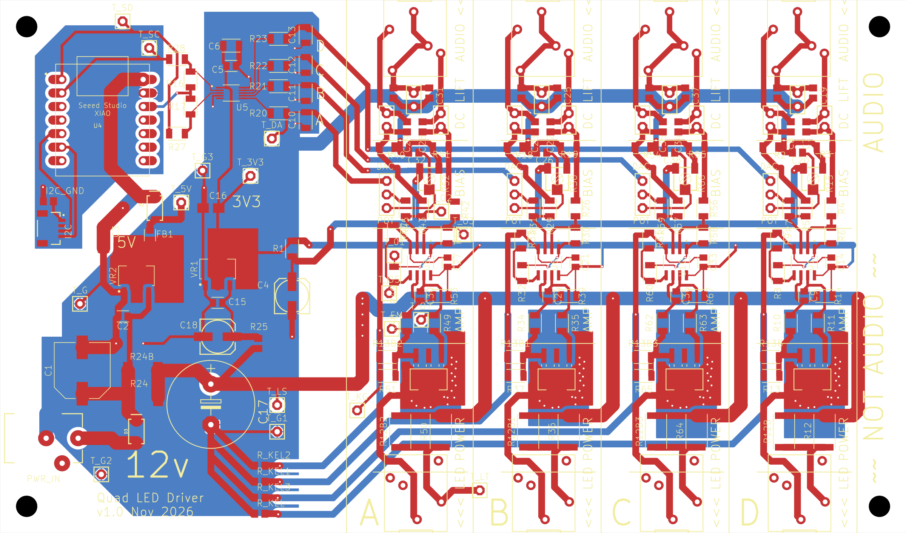

# Quad LED Driver: audio over light

A four-channel analog LED driver for sending audio-rate signals through the air as light: soundcard → LED → air → phototransistor pickup → soundcard. Each channel is a linear voltage-controlled current sink (op-amp, transistor, sense resistor), so the light follows the signal rather than the LED's exponential V/I curve. Audio rides on an idle brightness set per channel by an on-board DAC or a trimmer. The design clips cleanly at off and at full when the input is overdriven, and the op-amp's supply rail sets a hard ceiling on LED current.

*Quad LED Driver Board v1.0 (November 2026): 170 × 100 mm, two layers. On the left is the 12 V input, the 5 V and 3.3 V supplies, and a XIAO ESP32-S3 with an MCP4728 four-channel DAC for the idle brightness. On the right are four identical channels A–D, each with a balanced audio input, DC lift, bias select (DAC or trimmer), amplifier, current sink and LED output.*

*The routing: top copper in red, bottom copper in blue, with the silkscreen. Each channel's current-sense return runs back separately to the star point at the main capacitor (the four diagonal tracks at bottom centre).*

## Status

- **v1.0 boards** arrived on 2026-11-17. Channel A, the supplies and the DAC are built and working, and channels B–D are next.
- **Channel A, measured** over a bench optical link (`measure/`): about 67 dB SNR unweighted (69 dB(A)) at 1% THD, with a −3 dB bandwidth of about 67 Hz to 20 kHz. The limit is the photosensor's distortion, not the driver.

## What's here

| Path | Contents |
|---|---|
| [OVERVIEW.md](OVERVIEW.md) | Goals and approach |
| [TUTORIAL.md](TUTORIAL.md) | How one channel works, part by part, with figures in `tutorial/` |
| [WORKING.md](WORKING.md) | Design notes, schematic and board reviews, measurement and bring-up log |
| [BRINGUP.md](BRINGUP.md) | Breadboard bring-up of one channel, power, XIAO and DAC |
| [build_plan/](build_plan/) | Staged build-and-test guide for the PCB (`index.html`, generated by `make_page.py`) |
| [BOM_pcb.md](BOM_pcb.md), [BOM_breadboard.md](BOM_breadboard.md) | Parts lists |
| [schematics/](schematics/) | Fusion Electronics (Eagle format) schematics and boards, PDF prints, and circuit drawings (`channel.png`, `dac.png`, `power.png`, `supply_filter.png`) |
| [cam_output/](cam_output/) | Gerbers as sent to JLCPCB for v1.0 |
| [fab/jlcpcb/](fab/jlcpcb/) | JLCPCB's CAM job and design rules for Fusion |
| [kicad/](kicad/) | The board converted to KiCad 10, checked against the Fusion original |
| [dac_test/](dac_test/) | Test firmware (PlatformIO) for the MCP4728 bias DAC |
| [measure/](measure/) | `linkmeasure`: frequency response, noise and distortion of the optical link, with every run's results |

In normal use, the board joins an I2C network of ESP32 devices as a Peripheral, with the four LED channels as one Element. That firmware lives in a separate repository.

Raw audio recordings from the measurements are not in the repository; each run keeps its analysed results (CSV, PNG, JSON).
