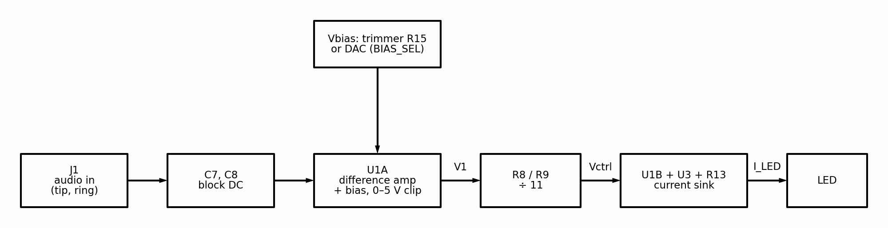
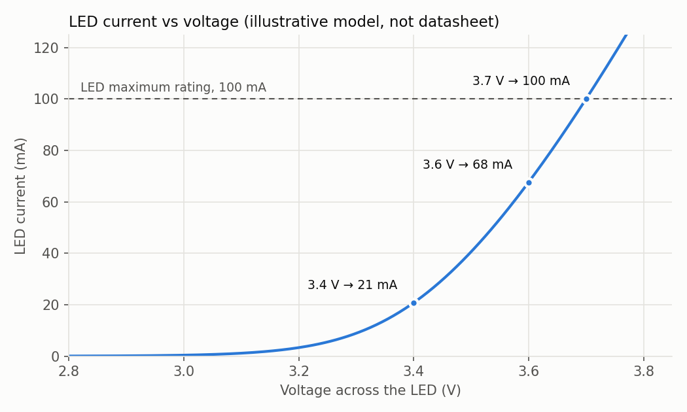
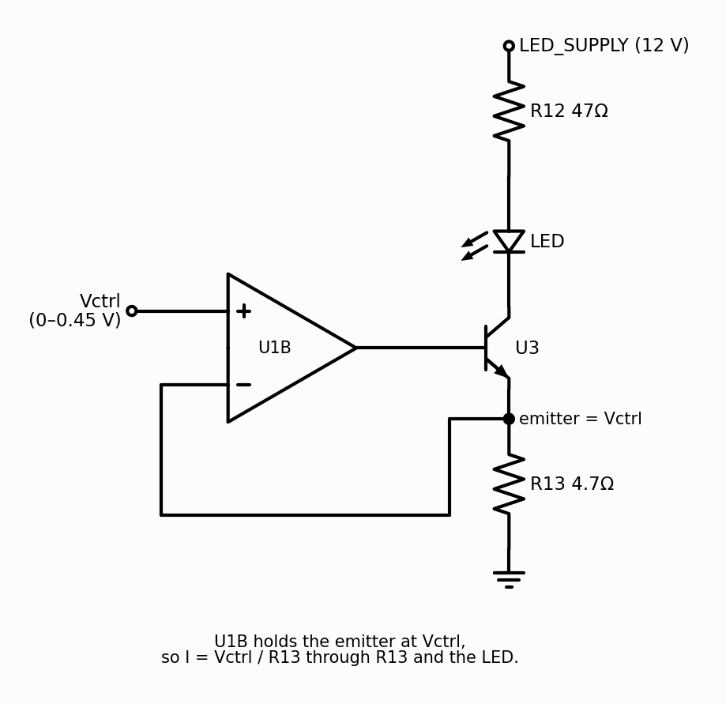
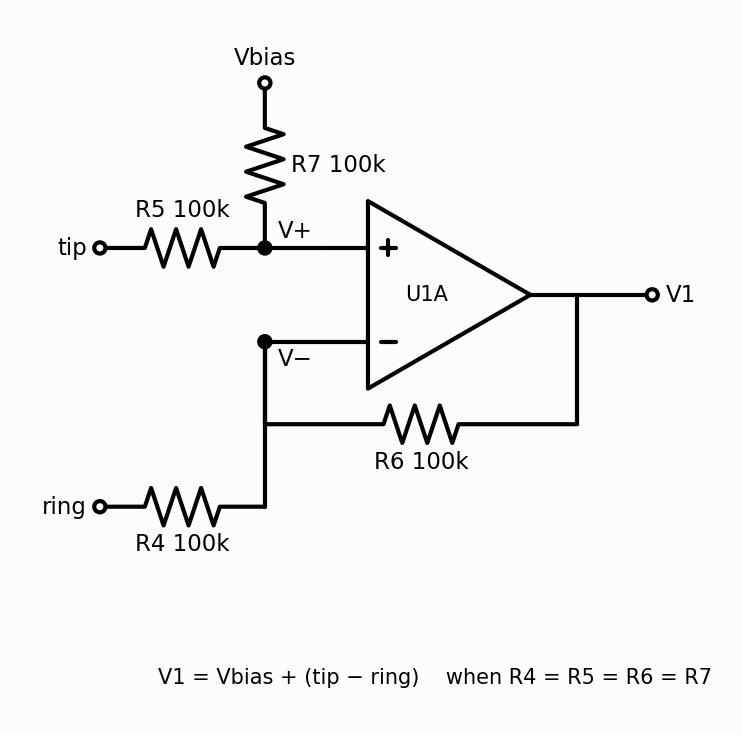

# How the LED driver channel works

A step-by-step explanation of one channel of the LED driver: what each part does, why it's there, and how its value was chosen. It starts with the big picture and then takes each section in turn.

Designators match `schematics/LED Driver.sch`. The full channel is drawn in `schematics/channel.png`; the figures here are simplified pieces of it.

> **3.3 V update (2026-10-23).** This tutorial uses the original **5 V** numbers. The design now runs U1 and the bias from **3.3 V**, and everything works the same way with these substitutions:
> - U1A clips at 0-3.3 V instead of 0-5 V;
> - R9 = 1.6k, so the divider is ÷7.25 instead of ÷11 (3.3 V → 0.455 V → ~95 mA);
> - R14 = 470k, giving a ~7 mV offset instead of 5 mV;
> - full audio swing is ±1.65 V peak instead of ±2.5 V.

> **A note on names.** This circuit isn't a *charge amplifier*. A charge amplifier is an op-amp with a capacitor in its feedback path, used to read piezo and capacitive sensors: it turns a packet of charge into a voltage. This channel is a **difference amplifier** feeding a **voltage-controlled current sink**. All three are built from the same op-amp idea (section 2), so what you learn here carries over.

---

## 1. The big picture

**The job:** turn an audio signal (plus a steady "idle brightness") into LED *current*, because the light coming out of an LED follows its current, not its voltage.

Reading left to right:

1. **J1** brings in the audio on two wires, tip and ring (a balanced connection).
2. **C7, C8** block any DC from the source, so only the audio gets through.
3. **U1A, the difference amplifier**, does three jobs at once:
   - takes the *difference* between tip and ring (which cancels hum, section 5.2);
   - adds the bias voltage Vbias, the idle brightness, set by the trimmer R15 or the DAC;
   - limits its output V1 to 0-5 V, because it can't swing past its supply. This is the safety ceiling (section 4).
4. **R8 / R9** divide V1 by 11, turning 0-5 V into 0-0.45 V.
5. **U1B + U3 + R13, the current sink**, makes the LED current exactly Vctrl ÷ R13.
6. **The LED** turns that current into light.

The whole channel in three equations:

| Step | Equation | Range |
|---|---|---|
| Difference amp | V1 = Vbias + (tip − ring), clipped to 0-5 V | 0-5 V |
| Divider | Vctrl = V1 ÷ 11 | 0-0.45 V |
| Current sink | I_LED = (Vctrl − 5 mV) ÷ 4.7 Ω | 0-96 mA |

The rest of this document explains why each of those is true, and why the numbers are what they are.

---

## 2. The op-amp in one page

Everything here rests on two rules. They hold whenever an op-amp has **negative feedback**: some of its output is fed back to its **−** input.

> **Rule 1:** the output moves to whatever voltage makes the − input equal the + input.
> **Rule 2:** the inputs draw (almost) no current.

That's all. The op-amp is a very high-gain amplifier: a microvolt of difference between its inputs would swing its output by volts. So with feedback, it settles where the difference is essentially zero.

The simplest example is a **voltage follower**: output wired straight to −. Rule 1 says output = − input = + input, so the output copies the input. Every circuit below is a variation on that.

**Real-world limits** that matter in this design:

| Limit | MCP6002 | LM358 (breadboard) | Why it matters here |
|---|---|---|---|
| Output range on a 5 V supply | ~0-5 V ("rail-to-rail") | ~0-3.5 V | sets the brightness ceiling (section 4) |
| Input range | 0-5 V | 0-3.5 V | inputs must work down to 0 V |
| Offset (how far from "equal" it really settles) | up to 4.5 mV | up to ~7 mV | ~1% error at full scale |
| Speed | 1 MHz | 1 MHz | plenty for audio |

**If the feedback goes to the + input instead, everything breaks.** The output runs off to one supply rail and stays there. That's what the swapped-input mistake in an earlier schematic would have done.

---

## 3. Why the LED needs its *current* controlled

An LED is a diode, and a diode's current rises *exponentially* with voltage:

In this (illustrative) curve, going from 3.4 V to 3.7 V, a change of under 10%, takes the current from about 21 mA to 100 mA, nearly five times as much. The curve also shifts as the LED warms up and differs from one LED to the next. So **driving an LED with a voltage is like steering with a hair trigger**: tiny voltage errors become huge brightness errors, and audio gets badly distorted.

Light output, on the other hand, follows **current** quite closely. So the circuit's real job is to set the current precisely and let the LED take whatever voltage it needs. That's what a *current sink* does.

Your original setup (5 V + a resistor) is a crude current limiter: the resistor takes up most of the variation. It's fine for "on", but it can't follow a signal linearly.

---

## 4. The current sink: U1B, U3, R13

This is the heart of the channel, so it comes first.

### 4.1 How it works
- U3 is a transistor used as a **valve**: the more its base is driven, the more current flows from collector to emitter.
- That current flows down through the LED, through U3, and then through **R13** to ground.
- The voltage on R13 (= the emitter voltage) is fed back to U1B's − input.

Now apply the op-amp rules. U1B adjusts its output (and so the valve) until − equals +, i.e. until **the emitter sits at Vctrl**. Ohm's law across R13 then fixes the current:

> **I = Vctrl ÷ R13**

The LED's own voltage never appears in that equation. Whether it needs 3.4 V or 3.8 V, warm or cold, the op-amp opens the valve just enough to give the right current. That's the whole trick.

(The current through R13 is the LED current plus U3's small base current, about 1%. Close enough.)

### 4.2 Choosing R13 = 4.7 Ω
R13 sets the *scale*: how many volts of Vctrl per mA of LED current. It's a trade-off:
- **Bigger R13** means a bigger control voltage, so the op-amp's small offset (a few mV) matters less. But more of the supply voltage is wasted across R13.
- **Smaller R13** wastes less voltage, but small errors become a bigger share of the signal.

A full-scale drop of about 0.45 V is a common compromise. For ~100 mA: 0.45 V ÷ 0.1 A ≈ 4.5 Ω, so the nearest standard value is **4.7 Ω** (full scale ≈ 97 mA). The MCP6002's 4.5 mV worst-case offset is then about 1% of full scale. That's fine, and it's also why "off" might leave a faint glow or a small dead zone at the very bottom.

Power in R13 at 100 mA: 0.1² × 4.7 ≈ 0.05 W. Any 1206 resistor copes.

### 4.3 Headroom: the one condition
The sink only works while U3 has some voltage across it to "throttle". Follow the 12 V down at full current:

| Where | Voltage drop |
|---|---|
| D1 (reverse-polarity diode) | ~0.4 V |
| R12 (47 Ω × 0.1 A) | 4.7 V |
| LED | ~3.7 V |
| R13 | 0.47 V |
| **Left for U3** | **~2.7 V** |

As long as U3 keeps at least ~0.5 V, everything above it (supply ripple, LED variation, R12) is irrelevant. That's why a noisy 12 V supply doesn't matter.

**If headroom runs out**, U3 is fully open and can't do any more. The current then comes out *lower* than asked for, never higher, and supply noise leaks into the light. That's what the 5 V vs 12 V question is about: at 5 V there's only ~0.8 V of slack.

### 4.4 R12 = 47 Ω: sharing the heat
On 12 V, about 8 V has to be dropped somewhere at full current. Without R12, U3 would burn 8 V × 0.1 A = 0.8 W, too much for a small package. R12 takes about 4.7 V of that, so U3 is left with about 0.3 W.

The value is chosen so that at the *maximum* current there's still ~2.7 V of headroom (section 4.3). A bigger R12 would cool U3 further but eat into headroom. R12 itself dissipates up to 0.1² × 47 ≈ 0.47 W, hence a 1 W (2512) part.

U3's worst case is actually around 75-80 mA, not at full current: about 0.3 W. A BCP56 handles that with some copper on its tab.

### 4.5 R11 = 470 Ω: between op-amp and transistor
- U3 needs a little base current: 100 mA ÷ a gain of ~100 = **~1 mA**. The op-amp supplies that easily.
- R11 limits what the op-amp can push into the base if something goes wrong, and isolates the op-amp from the transistor's base capacitance, which helps stability.
- Check it still works at full current: the op-amp output must reach emitter (0.47 V) + base-emitter drop (~0.75 V) + R11 drop (1 mA × 470 Ω = 0.47 V) ≈ **1.7 V**. That's well inside its 0-5 V range.

### 4.6 R10 = 1 kΩ and C9 = 100 pF: keeping it stable
A feedback loop that includes a slow component (here the transistor) can **oscillate**: the correction arrives late, overshoots, and the circuit rings at hundreds of kHz. You wouldn't see it, but it could add noise, heat U3, or confuse the pickups.

The fix splits the feedback by frequency:
- **At audio frequencies**, C9 is effectively an open circuit, so the − input hears the emitter through R10. Normal operation.
- **At very high frequencies**, C9 is effectively a short, so the − input hears the op-amp's *own output*. At those frequencies the op-amp behaves like a simple, stable follower and ignores the slow transistor.

The changeover is at f = 1 / (2π × R10 × C9) = 1 / (2π × 1 kΩ × 100 pF) ≈ **1.6 MHz**. That's far above audio, where only the oscillation would live. R10 also stops C9 from loading the emitter directly.

This is belt-and-braces: the circuit is often stable without it. BRINGUP.md stage 2b is where you'd notice if it isn't.

### 4.7 R14 = 1 MΩ: making zero really mean off
*(Added after bring-up: on the breadboard, the LED never quite went out.)*

A real op-amp doesn't settle at exactly "+ equals −". It's off by a few millivolts, its **offset** (up to ±7 mV for an LM358, ±4.5 mV for an MCP6002). If the offset happens to point the "wrong" way, a zero command still holds a few mV across R13. That's around 1 mA, and a white LED glows visibly at far less.

R14 runs from +5V_A to pin 6 and feeds a tiny current, 5 V ÷ 1 MΩ = 5 µA, through R10. That lifts pin 6 by 5 µA × 1 kΩ = **5 mV**, so the sink now regulates to:

> **I = (Vctrl − 5 mV) ÷ R13**

At Vctrl = 0 that would need a negative current, which is impossible, so U1B's output drops fully low and U3 turns completely off. The 5 µA itself flows through R10 and R13 to ground, never through the LED.

- **The cost:** a 5 mV dead zone at the bottom (about 1% of the range), and full scale drops from ~97 to ~96 mA.
- **Choosing the value:** it just has to beat the op-amp's offset. 1M (5 mV) worked on the breadboard with an LM358; 470k (~10 mV) would cover the LM358's worst case with room to spare.

---

## 5. The difference amplifier: U1A, R4-R7

### 5.1 How it works
Use the op-amp rules again, with all four resistors equal (100k):

1. **The + side** is a simple divider between tip and Vbias. With equal resistors, V+ is halfway between them:
   V+ = (tip + Vbias) ÷ 2
2. **The − side**: rule 2 says no current enters the − input, so the current coming in through R4 from ring must leave through R6 to the output. With equal resistors, V− is also halfway:
   V− = (ring + V1) ÷ 2
3. **Rule 1**: V− = V+, so (ring + V1) ÷ 2 = (tip + Vbias) ÷ 2, which gives:

> **V1 = Vbias + (tip − ring)**

So the output is the bias, plus the *difference* between the two audio wires.

### 5.2 Why take the difference? Hum rejection
The Tascam and this board each have their own ground. If the two grounds differ by a little hum voltage (a ground loop), that hum appears **equally on tip and on ring**, as seen from this board. A balanced output sends the audio as tip = +signal and ring = −signal, so:
- the **audio** is in the *difference* (tip − ring = 2 × signal), and is kept;
- the **hum** is the same on both, so (tip − ring) cancels it.

With an unbalanced (TS) cable, ring is grounded at the plug: V1 = Vbias + tip. It still works, you just lose the hum cancelling.

### 5.3 Why the four resistors must match
The cancelling only works if the + and − sides are scaled identically (R7/R5 = R6/R4). Any mismatch lets a fraction of the hum through. With ordinary 1% resistors the worst case is about **35 dB** of rejection; with 0.1% resistors about **55 dB**. That's why BOM_pcb.md suggests 0.1% for these four.

### 5.4 Why the bias always has a gain of exactly 1
If you work through the general case, the audio gain is R6/R4, but the bias always comes through at exactly ×1 *when the circuit is balanced*. You can make the audio more or less sensitive by changing the resistor ratios, but the bias can't be scaled without unbalancing the circuit. This is why the DAC needs a full 0-5 V range (the VDD-reference decision) rather than a gain tweak here.

### 5.5 Why 100 kΩ
- **High enough** not to load the soundcard (it sees roughly 100-200k), and so that the bias source's own resistance is negligible. The trimmer is at most 2.5k (at mid-travel), and the DAC's smoothing resistor is 1k: 1-2.5% of 100k.
- **Low enough** that resistor noise and the op-amp's tiny input currents don't matter.

### 5.6 The clip at 0 and 5 V is a feature
U1A runs from 0-5 V, so V1 can't go outside that range, however loud the input or however high the bias. After the ÷11 divider and R13, **5 V is ~97 mA**, so **no input can over-drive the LED**. Loud signals just clip cleanly at "off" and "full". For the feedback experiments, that's a safe, built-in nonlinearity.

---

## 6. The divider: R8 = 10 kΩ, R9 = 1 kΩ

It scales V1 (0-5 V) down to Vctrl (0-0.45 V): Vctrl = V1 × R9 ÷ (R8 + R9) = V1 ÷ 11.

- **The ratio** (÷11) is what makes "U1A at its 5 V limit" equal to "full current": 5 ÷ 11 ÷ 4.7 Ω ≈ 97 mA.
- **The values** (10k + 1k = 11k): small enough that U1B's input sees a low, quiet source (about 0.9k), large enough not to load U1A's output (5 V ÷ 11k ≈ 0.45 mA).
- **Changing the ratio changes the ceiling.** A bigger R9 would let the DAC reach full current with less voltage, but it would also let U1A's 5 V clip drive the LED past 100 mA. That's why R9 stays at 1k, even with an LM358.

---

## 7. The input: C7, C8 and R2, R3

### 7.1 C7, C8 (1 µF): block DC
A capacitor passes changing signals but blocks steady DC. If the source had a DC offset, it would shift the LED brightness. The caps remove it, so only the audio gets through.

Together with the resistance behind it, each cap forms a **high-pass filter**, with its corner at f = 1 / (2πRC). With roughly 100k behind 1 µF: 1 / (2π × 100k × 1 µF) ≈ **1.6 Hz**. That's below anything audible, and quick LFOs still get through. (Ceramic caps lose some capacitance under DC, so on the board the corner might be nearer 3 Hz. Still irrelevant.)

The DC-link option (a jumper across each cap) bypasses this for DC-coupled sources, such as a control voltage.

### 7.2 R2, R3 (1 MΩ): give the caps a reference
Without them, the node between each cap and its 100k resistor would have no defined DC voltage. The input would float, drift, and pop when you plug in. 1 MΩ is large enough to barely affect the signal (it's ten times the 100k).

Because they pull the U1A input nodes slightly towards ground, the op-amp's inputs sit at about 0.9 × Vbias rather than exactly at it. The output V1 is unaffected, because both sides are pulled equally.

---

## 8. The bias path: R15, BIAS_SEL, R1/C4, the DAC

- **R15 (10k trimmer)** connects across +5V_BIAS and ground, so its wiper gives any voltage from 0-5 V: the idle brightness.
- **BIAS_SEL** picks the trimmer (pins 2-3) or the DAC (pins 1-2) as Vbias.
- **R1 (100 Ω) + C4 (100 µF)**: anything on Vbias goes *straight into the light*, so the trimmer gets its own extra-clean supply. R1 and C4 form a low-pass filter at f = 1 / (2π × 100 Ω × 100 µF) ≈ **16 Hz**, which strips hum and digital noise from the 5 V rail. The cost is a small voltage drop: four 10k trimmers draw ~2 mA, which loses ~0.2 V across R1.
- **DAC path: R20 (1k) + C10 (1 µF)** smooths the DAC's steps (it updates a few hundred times a second for LFOs). The corner is at 1 / (2π × 1k × 1 µF) ≈ **160 Hz**. The resistor is deliberately small (1k, not 10k) because it adds to R7 and would unbalance the difference amp (section 5.3).

---

## 9. C14 (100 nF): decoupling

Every IC gets a small ceramic cap from its supply pin to ground, **right next to the pin**. When the op-amp's internal circuits draw quick bursts of current, the nearby cap supplies them locally, instead of through the long, inductive supply trace. Without it, op-amps can misbehave or oscillate. 100 nF is the standard value; its position matters more than its exact value.

---

## 10. Worked examples

All with the MCP6002 and R13 = 4.7 Ω (current = V1 ÷ 11 ÷ 4.7, or about **19.3 mA per volt of V1**):

| Bias | Audio (tip − ring) | V1 | LED current | What you get |
|---|---|---|---|---|
| 2.5 V | none | 2.5 V | 48 mA | half brightness, steady |
| 2.5 V | ±1 V peak | 1.5-3.5 V | 29-68 mA | clean modulation |
| 2.5 V | ±2.5 V peak (~+7 dBu) | 0-5 V | 0-97 mA | full swing, just touching both clips |
| 2.5 V | ±4 V peak | clipped 0-5 V | 0-97 mA, flattened | symmetrical clipping |
| 0 V | ±1 V peak | 0-1 V (negatives clip) | 0-19 mA, half-wave | gated / rectified sound |
| 5 V | ±1 V peak | 4-5 V (positives clip) | 77-97 mA | only dims downwards |

With an LM358 on the breadboard, V1 tops out at about 3.5 V, so the maximum is ~68 mA and everything above that clips.

---

## 11. When something's wrong: what it looks like

| Symptom | Likely cause | Section |
|---|---|---|
| LED fully on (or fully off) whatever you do | + and − swapped somewhere, so positive feedback | 2 |
| Brightness stops rising early; hum at full brightness | out of headroom | 4.3 |
| U3 warm with nothing changing; whine or haze in the pickup | oscillation | 4.6 |
| Hum in the pickups at idle | ground loop: try a TRS lead, check the R4-R7 matching | 5.2, 5.3 |
| Louder input makes it *dimmer* | tip and ring swapped (inverted) | 5.1 |
| Bias never reaches full on the breadboard | LM358's ~3.5 V output limit (expected) | 2, 10 |

---

## Glossary

- **Negative feedback:** feeding some of the output back to the − input, so the circuit corrects itself.
- **Rail:** a supply voltage (here 0 V and 5 V for the op-amps). "Rail-to-rail" means the output can swing close to both.
- **Offset:** the small voltage by which a real op-amp's inputs differ when it thinks they're equal.
- **Headroom:** spare voltage a regulating part needs in order to keep regulating.
- **Balanced signal:** audio sent on two wires as +signal and −signal, so interference that hits both equally can be cancelled.
- **Corner frequency:** where a simple RC filter starts cutting, f = 1 / (2πRC).
- **Decoupling:** a small capacitor at an IC's supply pin that supplies quick bursts of current locally.
