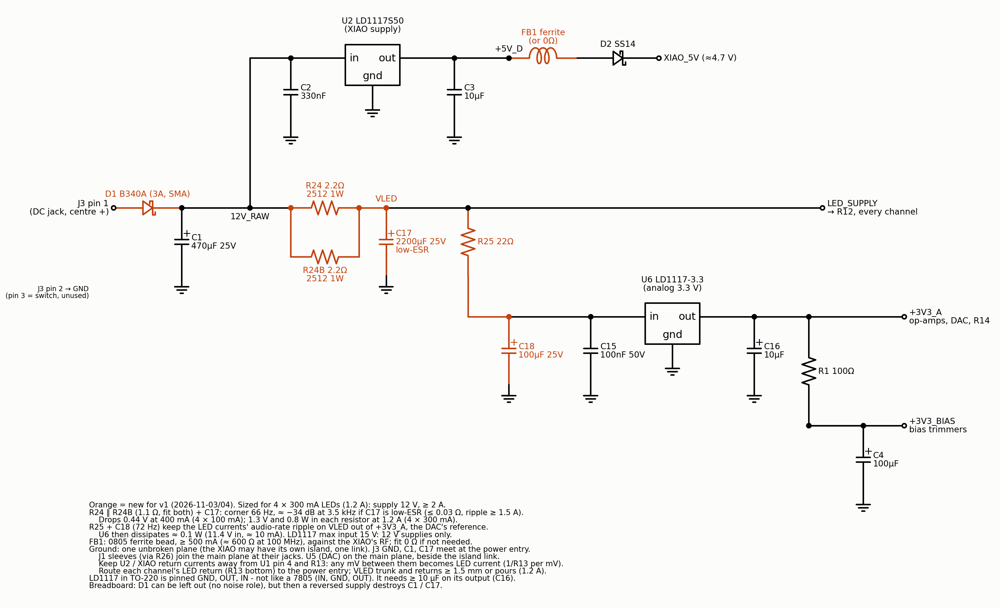
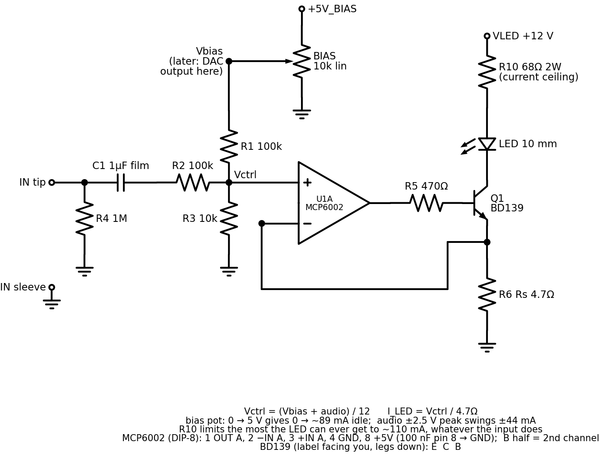
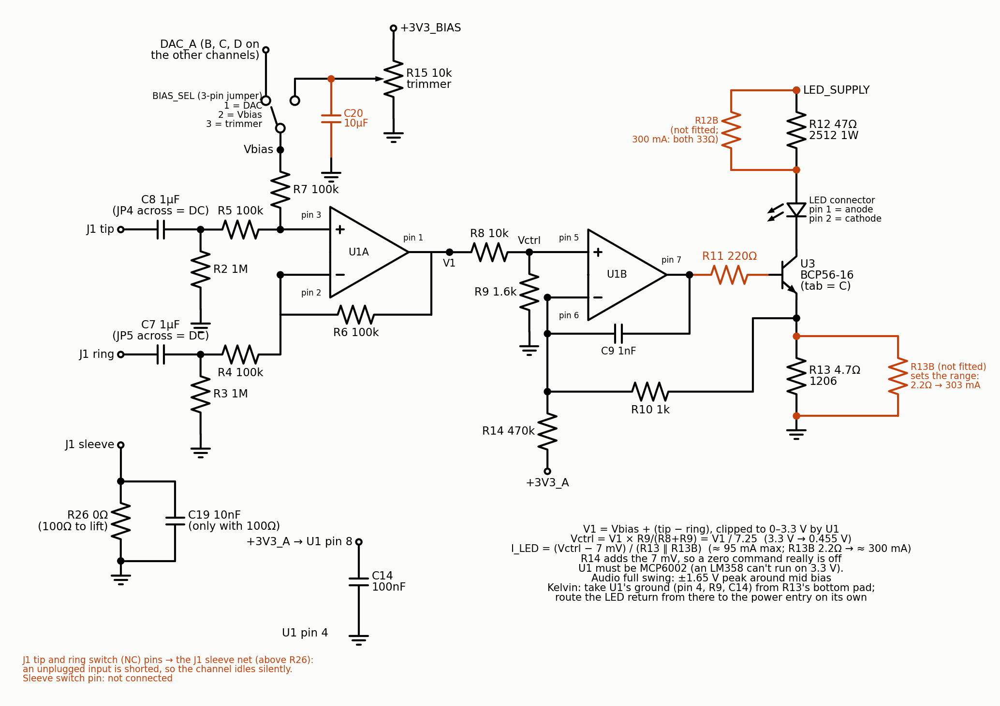

# LEDAudioDriver - working notes

## PCB build-up (2026-11-17) - read this first
- **v1.0 boards have arrived** (Quad LED Driver Board, JLCPCB). Dave has all the parts.
- **Build-and-test plan:** `build_plan/index.html`, published as the private artifact https://claude.ai/artifact/QDr8fG4J7KQPshFgZTznb5. It has five stages:
  - 0: bare-board resistance checks;
  - 1: power, with a 100 mA bench limit;
  - 2: channel A on its trimmer, 200 mA limit;
  - 3: XIAO + DAC, then `dac_test` and the real firmware, 300 mA limit;
  - 4: channels B-D, 600 mA limit.
- **What each stage contains:** an overview picture, a labelled close-up, a parts checklist, a probe picture and the expected readings. Ticks and readings are kept in the browser (localStorage) only.
- **Regenerating it:** `python3 make_images.py`, then `python3 make_page.py` in `build_plan/`. The pictures come from the .brd (`brd.py` parses it, `render.py` draws it), and the stage data is in `stages.py`.
- **Designators on the quad board:**
  - Strip A uses the "2" names (U8 op-amp, U7 BCP56, R40-R53, C27-C32, BIAS_SEL2, R_KEL2).
  - Strip B uses the "1" names (U6, U2, R18 / R19 / R26 / R29-R39, C21-C26).
  - Strip C uses the "3" names (U10, U9, R54-R67, C33-C38).
  - Strip D uses the plain names (U1, U3, R2-R15, C7-C9 / C14 / C19 / C20).
  - Power: VR1 = LD1117S33, VR2 = LD1117S50, D3 = B340A.
  - Strip A has test points T_01 / T_O2 / T_O3 / T_O5 / T_O7 / T_EM / T_KG / T_LT. T_O2 is on U8 pin 3 and T_O3 on pin 2: the names are the other way round from the pins.
- **Results** (record them here as Dave reports them):
  - **2026-11-17, channel A first light** (stages 1-2 built; no XIAO / DAC; BIAS_SEL2 on POT, trimmer ~mid ≈ 1.65 V ≈ 48 mA bias; tissue paper over the LED so the pickup doesn't saturate; In 2 not connected). Dave: "sounds fairly good". Run `measure/runs/20261117-221902_pcb_A_trimmer_mid_tissue`. Compared with the best breadboard runs (`newsupply_filter_fixedgnd_r13_250`, `supplyfilter_reseated_r13_250`, `housing_250`, `c10_fitted`): plots `runs/compare_20261117-222028_*.png`, table `runs/summary_20261117-222029.md`.
    - **Response: same as the breadboard,** −3 dB 79 Hz-18.9 kHz. The pickup sets it, not the driver.
    - **Hum: gone.** 50 Hz is at −106.6 dB re signal, against −91.7 on the best breadboard run, and the 50 Hz comb has disappeared: no peaks above the floor at all.
    - **Broadband noise: about 4-5 dB worse relative to signal** (−82.5 vs −87.0 dB re signal; SNR 49.5 vs 53.9 dB at −30 dBFS drive). The floor sits ~6 dB higher below 300 Hz and ~8 dB higher above 3 kHz.
      - The 1 kHz gain is +0.4 dB, against +21 to +28 dB in the housing: the tissue and placement cut the optical coupling by ~26 dB. So noise that doesn't scale with the signal (pickup / preamp floor, photocurrent shot noise) probably counts for more.
      - **LED-off check** (`20261117-222338_pcb_A_trimmer_zero_tissue`; trimmer at zero, same knobs): −94.9 dBFS, −98.8 dBFS(A), the same as the breadboard's LED-off floor (−93 to −96). That is **12.8 dB below the LED-on noise**, so the photosensor / preamp floor adds only ~0.2 dB. **The hiss is carried by the light**, and the tissue isn't costing anything through the floor.
      - The LED-off floor has the narrow lines 434 / 1302 / 1592 Hz (+16-20 dB above the floor), the same ones as `newsupply_after_glitch_r13_250` on 2026-11-03. They're there with the LED dark, so they're on the receive side or the shared ground, not in the light. With the LED on they're ~25 dB under the hiss.
      - Next: does the hiss scale with bias? Run `all` at a quarter-turn trimmer setting. If noise re signal improves at lower bias, the noise is proportional to the DC light (LED, bias or shot noise), and a lower bias with less tissue is the better operating point.
      - **Quarter turn, no tissue** (`20261117-222606_pcb_A_trimmer_quarter_notissue`; expected ≈ 0.8 V ≈ 24 mA bias): **the photosensor saturating** (confirmed: see the ripped-tissue note below).
        - Gain −18 dB (was +0.4 with tissue at mid), −3 dB HF 8.1 kHz, THD 15% at −30 dBFS drive (H2 −16 dBc).
        - Noise −96.0 dBFS, which is the LED-off floor: in saturation the light's noise gets no gain either. Same signature as `housing_2048` on 2026-11-03.
        - The distortion expands rather than compresses. H2 rises dB for dB with drive (−36 dBc at −50 dBFS → −16.5 at −30), and at −20 dBFS drive the fundamental jumps 18 dB for 2 dB more drive. The bias point is in saturation, and the troughs dip back into the linear region.
        - This doesn't answer the bias question, because two things changed. Clean A/B: tissue back on, quarter turn, compared with mid + tissue. Without tissue the bias has to stay well under ~12 mA (as in the housing), and the troughs then cut off at a lower drive.
      - **Quarter turn, "tissue back"** (`20261117-223115_pcb_A_trimmer_quarter_tissue`): **invalid. The tissue had ripped** (Dave), so the light was unattenuated and the photosensor saturated, as in the run before. Gain −13.2 dB, 7.3 kHz, THD 17%, noise at the floor. I wrongly read it as the LED being barely on; ignore that.
      - **Quarter turn, tissue repaired** (`20261117-224953_pcb_A_trimmer_quarter_tissue_fixed`): **best link measurement so far.** Dave: "sounds good".
        - Gain +12.3 dB, −3 dB 78 Hz-19.7 kHz.
        - Noise −78.3 dBFS = **−90.6 dB re signal** (mid + tissue −82.5; best breadboard −87.0). **SNR 57.7 dB at −30 dBFS drive** (best breadboard 53.9), and ≈ 67 dB at −20 dBFS drive (1.1% THD there).
        - **Figure to quote: SNR ≈ 67 dB unweighted, ≈ 68 dB(A), at 1% THD** (1 kHz, 20 Hz-20 kHz, whole link). 1% THD falls at ≈ −21 dBFS drive (0.87% at −22, 1.14% at −20). −90.6 dB re signal is the noise relative to a 0 dBFS drive, which the link can't pass cleanly, so it isn't an SNR.
        - Broadband floor re signal matches the best breadboard runs, with no hum comb (50 Hz −116.8 dB re signal).
        - THD 0.42 / 0.34 / 0.46% at 100 / 1k / 5k, H2-dominated (H3 −73 to −96 dBc). Best THD+N 0.30% at −34 dBFS drive. No input clipping up to −20 dBFS drive.
        - **Caveat:** the repaired tissue probably attenuates differently. Gain is +12 dB higher at half the bias, so this isn't a clean bias A/B against mid + tissue. The likely reading is the breadboard's: less DC light per unit of signal is better, as long as the pickup stays out of saturation and the troughs out of cutoff.
        - Plots `runs/compare_20261117-225100_*.png`, table `runs/summary_20261117-225102.md`.
        - The proper way to map bias is `biassweep` once the XIAO + DAC are fitted (stage 3). The XIAO S3 is native USB, so `--dac auto` (which looks for a USB-serial chip) may need the port given explicitly.
  - **2026-11-19, stage 3: DAC fitted.**
    - Outputs B / C / D followed their codes first time.
    - **A read a constant 1.2 V whatever the code: U5 pin 6 (VOUTA) wasn't soldered.** Dave reflowed it, and A now follows its code.
    - BIAS_SEL2 stayed on POT throughout. So my guess that the jumper move charged C10 from the trimmer was wrong. With pin 6 open, the DAC_A node (C10 10 µF, R20, T_DA, header pin 1) floats, and probably sat at whatever leakage or a part-contact gave it.
    - For the next boards: an MSOP output stuck at a constant voltage = that pin's joint. Probe the leg, not the pad.
    - `check` passed; BIAS_SEL2 moved to DAC. `dac_test` running on the on-board XIAO S3 (USB to the laptop, `/dev/cu.usbmodem2101`; `--dac` needs the port given, since `auto` only looks for USB-serial chips).
  - **2026-11-19, DAC bias sweep with a 3× longer test tube, no tissue** (`20261119-191452_pcb_A_tube3x_biassweep_coarse`, codes 100-4000 step 300, −30 dBFS):
    - **Usable window: codes ~400-2200.** Gain +17.5 → +14.1 dB across it, THD ≤ 1%, noise flat at −72 to −74 dBFS.
    - Code 100 cuts off on the troughs (37% THD).
    - **The photosensor saturates above ~2500.** The cliff is at 2800 (≈ 2.25 V Vbias ≈ 66 mA), where gain falls by 23 dB and noise drops to the floor. So the tube gives about the same coupling as the repaired tissue, repeatably.
    - Lowest THD 0.33% at code 700 (H2 −49.7, H3 −78.5 dBc). Lowest noise re signal at 400, where H3 is starting to rise (−64 dBc).
  - **Full runs at codes 700 and 1350** (`20261119-191622_pcb_A_tube3x_dac700`, `20261119-191724_pcb_A_tube3x_dac1350`; levels to −12 dBFS; plots `runs/compare_20261119-191831_*.png`, table `runs/summary_20261119-191830.md`):
    - **Code 700 = the operating point.** Gain +17.3 dB, −3 dB 75 Hz-20 kHz.
      - Noise −90.5 dB re signal (= the tissue run's −90.6); THD 0.33 / 0.47 / 0.42% at 1k / 100 / 5k; best THD+N 0.30% at −34 dBFS.
      - 1% THD at ≈ −20.5 dBFS drive → **SNR ≈ 67 dB unweighted, ≈ 69 dB(A) at 1% THD**, the same as the tissue run.
      - 50 Hz −116 dB re signal, and no spectral peaks at all: the on-board XIAO running (on USB) adds nothing.
    - **Code 1350 is worse in every way:** THD 0.58% at −30 dBFS, noise −88.4 dB re signal, 1% THD already at ≈ −25 dBFS drive.
      - The distortion is the photosensor's H2, which grows with the light. A higher bias therefore costs linearity, rather than buying headroom against trough cutoff.
      - LF −3 dB 66 Hz (vs 75): the pickup's corner moves a little with light.
    - In 1 clips at −16 dBFS drive (+17 dB link gain), so the link's own limit above −18 dBFS isn't measured. Turn In 1 down ~6 dB to see it.
  - **The 100-500 Hz "ringing" in every frequency response was the analysis, not the hardware** (Dave spotted it).
    - It was a ripple of about ±0.2 dB with peaks every ~97 Hz (133, 228, 325, 420, 520 Hz…), on every run since October, and also in the In 1 / In 2 transfer.
    - Cause: `deconvolve` started its window 10 ms before the impulse peak and cut off the band-limited impulse's low-frequency pre-ringing (spacing ≈ 1 / 10 ms). Re-analysing the same recording with the window starting 50 or 200 ms before the peak gives a smooth curve.
    - **Fixed in `linkmeasure.py`:** the window now starts up to 100 ms before the peak, capped at half the gap to the 2nd-harmonic response. New `reanalyse` command recomputes saved runs.
    - **The low −3 dB points were ~7-9 Hz too high.** Re-analysed: dac700 67 Hz (was 74.7), dac1350 59 Hz (65.9), tissue_fixed 70 Hz (77.6; high end now 20 kHz), `newsupply_filter_fixedgnd_r13_250` 63 Hz (71.8). Gains at 1 kHz are unchanged. Other runs still have the old numbers until re-analysed.
    - `compare` now orders runs by date: newest drawn on top, first colour, top of the legend. Plots `runs/compare_20261119-192636_*.png`.
    - **THD: as good as the breadboard at 1 kHz** (0.34% at −30 dBFS drive vs 0.37%), the same 2nd-harmonic-dominated optical curve (H3 −90 dBc). **5 kHz is much better** (0.13% vs 1.6% in `housing_250`): the higher bias keeps the driver out of cutoff on the troughs, as predicted on 2026-11-03.
    - No input clipping up to −20 dBFS drive (1.05% THD there), so the tissue gives ~10 dB more usable drive than the housing runs.

## Current state (2026-10-23)
- **Design (decided 2026-10-23): 3.3 V analog.** Two-op-amp channel (balanced input + rail clamp) × 4. 12 V in. U2 (L78M05) → +5V_D for the XIAO only. **U6 (LD1117-3.3) → +3V3_A** for U1 (MCP6002), the bias trimmers (+3V3_BIAS via R1/C4) and the MCP4728. DAC VDD reference = 0-3.3 V, directly on the XIAO's I2C - **no level shifter**. Channel: **R9 = 1.6k** (3.3 V → 0.455 V → ~95 mA), **R14 = 470k** (~7 mV offset). LED_SUPPLY_SEL removed (LEDs always on VLED). XIAO ESP32-S3 on board as an I2CElectronics Peripheral.
- **Fusion schematic:** `schematics/LED Driver.sch` is still the 5 V version - Dave to update it: add U6/C15/C16, rename the rails, change R9/R14, remove Q2/Q3/R18/R19 and LED_SUPPLY_SEL, and wire BIAS_SEL pin 1 ← DAC_A (still pending the 4-channel modules vs design blocks decision).
- **Drawings:** `schematics/power.png`, `channel.png`, `dac.png` - updated to 3.3 V (2026-10-23); designators follow the Fusion schematic, plus new U6, C15, C16.
- **Parts:** `BOM_breadboard.md` (through-hole, for breadboarding), `BOM_pcb.md` (SMD, keyed to designators).
- **Next:** rebuild the breadboard at 3.3 V with the correct capacitors, following **`BRINGUP.md`** - its new "3.3 V rebuild" table overrides the 5 V values in the stages.
- **Explainer:** `TUTORIAL.md` - how the channel works and why each value was chosen (figures in `tutorial/`, generated by `tutorial/draw_tutorial_figs.py`).
- **Explainer caveat:** `TUTORIAL.md` still uses the 5 V numbers (÷11, ~97 mA, R14 = 1M); the principles are unchanged.
- Open: repeated blocks in Fusion; LightChannel Element firmware; the low-end "stuck bright" / squeal on the breadboard (re-test after the rebuild with correct C9/C14 values). The LED supply stays 12 V (the 5 V-only LED option is dropped with the 5 V analog rail).

## Status history
- 2026-09-27: LEDs confirmed 10 mm, 100 mA, 3.7 V. Board to carry its own XIAO + MCP4728.
- 2026-10-04: XIAO runs from the analog 5 V via a Schottky (D2) rather than its own regulator.
- 2026-10-04: simple one-op-amp channel proposed, then superseded on 2026-10-06 by the two-op-amp version Dave drew in Fusion.

## Power

(Drawn with schemdraw from `schematics/draw_power.py`. The earlier ASCII version was drawn wrongly - caps in series with the rail and a line from 12 V to GND - ignore any copies of it.)

- The current sink ignores ripple on VLED (as long as there's headroom), so the LED side only needs bulk capacitance.
- The regulator knocks down supply noise for the op-amps; the extra RC on the bias supply matters most, because anything on Vbias goes straight into the light.
- The diode is reverse-polarity protection (optional).
- XIAO: its 5V pin is wired straight to USB VBUS, so D2 stops the board back-feeding the computer's USB port when both are connected. The XIAO gets ≈4.7 V, fine for its own 3.3 V regulator. With the radio off it draws ~50 mA, so the 7805 dissipates ≈0.5 W - OK without a heatsink.
- All grounds common. A 5 V bench supply can replace the whole lot for early testing (use a 0 Ω link instead of R_drop - see below).

## Simple channel (one op-amp) - SUPERSEDED

(2026-10-06: Dave built the two-op-amp version in Fusion. This drawing's designators clash with LED_Driver.sch, so it has moved to `schematics/superseded/`. Kept for the explanation below.)

How it works, part by part:
- **R1, R2, R3 (100k, 100k, 10k):** a passive mixer + attenuator. Bias (through R1) and audio (through R2) are averaged at Vctrl, and R3 pulls the result down: Vctrl = (Vbias + audio) / 12. 100k keeps the load on the soundcard and the pot light; 10k sets the ÷12 so 5 V of bias → 0.42 V → ~89 mA.
- **C1 (1 µF film):** blocks DC from the source. With ~110k behind it the corner is ~1.5 Hz, so all audio and quick LFOs get through. Film rather than electrolytic: no polarity, lower distortion.
- **R4 (1M):** gives C1 a path to ground so the input doesn't float (fewer pops on plugging in). Big enough to not load anything.
- **BIAS pot (10k linear, between +5V_BIAS and GND):** sets idle brightness. Later the DAC output connects at Vbias instead.
- **U1A + Q1 + R6 (the current sink):** the op-amp drives Q1's base until the voltage on R6 (= I × 4.7 Ω, fed back to the − input) equals Vctrl. So I_LED = Vctrl / 4.7 Ω, regardless of the LED's own curve or supply noise. 4.7 Ω is chosen so full current needs only ~0.45 V - enough to be accurate (the MCP6002's 4.5 mV max offset is ~1%), small enough to waste little voltage.
- **R5 (470 Ω):** limits the op-amp's output current and isolates it from Q1's base capacitance (helps stability). Q1 needs ~1 mA base current at 100 mA; the op-amp only has to reach ~1.7 V to deliver that.
- **R10 (68 Ω, 2 W):** burns off the extra voltage from 12 V so Q1 stays cool, *and* sets a hard ceiling: even with Q1 fully on, (12 − 3.7 − 0.2) / (68 + 4.7) ≈ 110 mA. Below ~100 mA there is still ≥1 V across Q1, so the sink stays in control. Worst-case Q1 dissipation is ≈0.25 W (around 60 mA).

Numbers: bias pot 0 → 5 V gives 0 → ~89 mA idle; audio ±2.5 V peak (≈ +7 dBu) swings ±44 mA around mid. For more audio sensitivity, lower R2 (e.g. 47k roughly doubles it).

What it gives up compared with the two-op-amp version:
- **No balanced input** - an unbalanced cable can pick up ground-loop hum. Often fine if the 12 V supply is a floating (non-earthed) wall adapter.
- **The ceiling comes from R10, not from clipping at the 5 V rail** - works on 12 V; on a 5 V-only supply there is no room for a ceiling resistor and a large input could push 150 mA+.
- **No compensation network** (the old R12 1k / C3 100 pF). Usually not needed with the MCP6002; add them if the loop oscillates (bring-up step 6).

One MCP6002 = two simple channels (A and B halves).

## Full channel (two op-amps: balanced input + clamp)

(Drawn from `schematics/draw_channel.py`. Fixed 2026-10-04: tip goes to the **+** side and ring to the - side. The ASCII version had them swapped, which would have inverted the signal.)

- AC-coupling caps on tip and ring, each with a jumper to short them for DC-coupled sources.
- 1M bleed resistors so an unplugged / AC-coupled input sits at 0 V → channel idles at Vbias.
- Unbalanced (TS) cables work too: ring = sleeve = ground.

### Transfer, in words
- Nothing plugged in: brightness = bias pot. Bias at mid ≈ 40 mA ≈ half brightness.
- Audio at bias-mid: ±2.5 V peak (≈ +7 dBu) sweeps off → full. More than that clips at off and at full.
- Bias at 0: only positive half-waves light the LED → half-wave-rectified, gated sound (useful nonlinear mode).
- Bias at max: solid full on; negative-going audio dims it.
- Max current is fixed by 5 V × (1/11) / Rs, so no input can over-drive the LED.

### Numbers at full current (100 mA worst case, Rs 4.7R)

| Supply | R_drop | V across Q1 | Q1 power | R_drop power | Headroom OK? |
|---|---|---|---|---|---|
| 5 V | 0 | 5 − 3.7 − 0.47 ≈ 0.83 V | 0.08 W | - | just (Q1 sat ≈ 0.2-0.3 V) |
| 12 V | 0 | ≈ 7.8 V | **0.78 W - too hot for TO-92** | - | yes |
| 12 V | 47R 1W | ≈ 3.1 V | 0.31 W | 0.47 W | yes, ~3 V spare |

- 12 V with R_drop is the recommended setup: plenty of headroom (so supply noise is rejected), modest heat in both parts.
- BD139 (TO-126) is comfortable at 0.3 W with no heatsink; BC337 (TO-92, 625 mW max) will run warm - fine for breadboard tests at 5 V.
- Base drive: 100 mA / hFE (~100 worst case) ≈ 1 mA from the op-amp - fine for MCP6002 / TLV9062.
- LED longevity: 10 mm LEDs at a continuous 100 mA get warm. Default to 5.6R (≈ 80 mA); drop to 4.7R only if more light is needed.

### Part choices
- Breadboard op-amp alternatives (2026-10-04): needs inputs that work down to 0 V on a single supply. **LM358 / LM2904 / LM324** work (output only reaches ~3.5 V on 5 V: fine for the current sink; in the two-op-amp version keep R9 = 1k and accept ~68 mA max (2026-10-06; raising R9 to 1.5k was suggested earlier, then withdrawn as unsafe during staged testing); inputs driven below −0.3 V can make the output jump high, so add a small Schottky from GND to Vctrl if bias is near 0 with hot audio). Also fine: TLC2272, TLV2372, MCP602, LMC6482, OPA2340. **Not** usable: TL072/TL082, NE5532, LM741 (inputs can't go near ground on a single supply), LM393 (comparator, same pinout).
- U1: dual rail-to-rail-input-and-output op-amp on 5 V: MCP6002 (cheap, 1 MHz) or TLV9062 (10 MHz, lower noise, 5.5 V abs max). Quad versions (MCP6004 / TLV9064) = 2 channels per chip. Must run from the 5 V regulator, never 12 V.
- Q1: BD139 (board), BC337 (breadboard at 5 V).
- Rs: 5.6R or 4.7R, 0.25 W is enough (≤ 0.05 W).
- R_drop: 47R, 1 W (or 2 × 100R 0.5 W in parallel).

## Breadboard bring-up plan
Superseded 2026-10-06 by `BRINGUP.md` (matches the current design and designators).

## Supply: 5 V vs 12 V (open decision, 2026-10-04)
A linear driver always turns (supply − LED voltage) × current into heat, so the supply voltage sets the waste.

| Per channel at 100 mA | Power in | LED | Heat | Efficiency |
|---|---|---|---|---|
| 12 V, simple channel (R10 68 Ω) | 1.2 W | 0.37 W | 0.83 W | ~31% |
| 5 V, full channel (no R10) | 0.5 W | 0.37 W | 0.13 W | ~74% |

Four channels full on: ~3.3 W of heat at 12 V vs ~0.5 W at 5 V.

- **Simple channel on 5 V:** possible, but a ceiling resistor is imprecise there. The ceiling is (5 − Vf − 0.2) / (R10 + Rs), and the 1.1 V on top is a small difference of two big numbers, so ±0.2 V of LED or supply variation moves it by ±20%. At 12 V the same variation hardly matters.
- **Full (two-op-amp) channel on 5 V:** stage 1 clips at the 5 V rail, so the ceiling is exact (5 V ÷ 11 ÷ Rs) without any power resistor. Costs the other half of the MCP6002 (1 chip per channel instead of per 2) and ~6 resistors, and brings the balanced input with it. No 7805 needed; Q1 can be a BC337. Use Rs = 5.6 Ω (≈ 80 mA) so the sink keeps ~1 V of headroom. If headroom ever runs out, the current comes out *lower* than asked for, never higher.
- Decide after bring-up step 2: measure Q1 collector-emitter voltage at full current on 5 V. If it stays above ~0.5 V, go 5 V + full channel.

## Why the balanced input
The light link isolates the *receive* side (pickups are only wired to the Tascam). The risk is on the *transmit* side: the audio cable joins the Tascam's ground to the driver board's ground, and there is likely a second path between them:
- driver board → I2C network ground → Central → USB → computer → Tascam (probably the main one in this installation)
- the XIAO's own USB cable while programming
- mains earth, if the power adapter is earthed (most small adapters aren't)

Any voltage between the two grounds (50 Hz hum, motor currents from other Peripherals returning through shared grounds) adds to the input signal. With the simple channel, 10 mV of ground noise is roughly −48 dB below full swing - audible in quiet passages, and amplified by any feedback loop. Fixes: the balanced difference-amp input (full channel), or a plug-in audio ground-loop isolator transformer between Tascam and driver (cheap, no circuit change, but cuts below ~20 Hz).

## Open questions / to check
- Tascam US-4x4HR line outs are almost certainly AC-coupled (DC-blocking caps), so "full on" from the soundcard means a signal > ~+7 dBu, or the bias pot / bias CV. Check by sending a very slow ramp and metering the output.
- Bias control: see "On-board ESP32 + DAC bias control" below.

## On-board ESP32 + DAC bias control (decided 2026-09-27)
The board carries its own ESP32 and joins the I2C network as a Peripheral, with the LED channels exposed as an Element. Brightness, on/off and LFOs then work without the soundcard; soundcard audio still rides on top of whatever the DAC is doing.

- **ESP32:** same XIAO ESP32-S3 as the other Peripherals, so it runs the common Peripheral firmware. It is an I2C *slave* on `Wire` (network bus) and an I2C *master* on `Wire1` (local bus to the DAC).
- **LFOs:** generated on the ESP32 and written to the DAC at ~500 Hz-1 kHz; the network only carries settings. Good up to tens of Hz; audio-rate stays on the soundcard. Better as a shared modulation layer in the Peripheral framework (any Element parameter can have an LFO) than per-Element code - the LED Element then just exposes `level` per channel.

### DAC options
| Option | Cost | Channels | Notes |
|---|---|---|---|
| **MCP4728** (recommended) | ~£1.50 chip / ~£3 breakout | 4 | 12-bit, internal 4.096 V reference (quiet), EEPROM power-up values. One chip = whole board. |
| ESP32 PWM + 2-stage RC filter | ~free | up to 8 | 12-bit at ~19.5 kHz; filter ~200 Hz. But: 0-3.3 V range (only ~2/3 of full current without extra gain) and noise from the 3.3 V digital rail goes straight into the light. OK for on/off, marginal for a quiet idle. |
| Original ESP32 built-in DAC | free | 2 | 8-bit - too coarse at low brightness, only 2 channels, and the S3 doesn't have it. |
| I2S audio DAC (PCM5102 board) | ~£3 | 2 per board | Only if the board should make its *own* audio-rate signals (oscillators, noise, samples). DC-coupled, ground-centred output. Separate idea; not needed for bias. |

MCP4728 details:
- RC low-pass on each output: **1k + 1 µF ≈ 160 Hz** (changed 2026-10-06 from 10k + 150 nF). The smoothing resistor adds to R7 in the difference amp, so it must be small next to 100k: 10k would unbalance it by 10% (hum rejection down to ~26 dB); 1k is 1%.
- ~~Internal 2.048 V reference, gain ×2 → 0..4.096 V ≈ 82% of full-scale~~ (2026-10-06: use **VDD as reference** instead - see below).
- EEPROM: each channel comes up at a stored brightness before the ESP32 talks to it.
- Per channel, a jumper/switch picks bias pot or DAC as Vbias (pot is useful for bench testing without firmware).

### Power / grounding with an ESP32 on board
- Decided 2026-10-04: radio stays off, so the XIAO shares the analog 5 V (via D2) rather than having its own regulator. If WiFi/BLE is ever turned on, its current spikes (a few hundred mA) would need a separate regulator again.
- Keep the LED current return (Rs grounds) and the ESP32 ground on separate traces meeting at one point near the power input.

### Software
Built 2026-10-22 in the I2CElectronics conversation: Element type `LIGHT_DAC` — one per board, four independent parameters `LIGHT_1..4` (one per DAC output), config SDA_PIN / SCL_PIN (D0/D1 = GPIO 1/2) / I2C_FREQ / DAC_ADDRESS / MIN_LEVEL / MAX_LEVEL / GAMMA / VREF / GAIN / IDLE_LEVEL / EEPROM_SYNC — an `Mcp4728` driver that fast-writes all four channels once per tick, `loop_ms` (5) in board.json, and a `peripheral-led` PlatformIO env with ready-made `data/peripheral-led/` files. Power-up: the lights are at IDLE_LEVEL (full) and the firmware keeps the DAC's EEPROM equal to that, so the LEDs are on before the ESP32 has booted. Flash: `pio run -e peripheral-led -t uploadfs` then `-t upload`. Details: `I2CElectronics/doc_claude/WORKING.md` (2026-10-22). Not yet run on the board.

## PCB route
- Fusion Electronics: draw by hand from these schematics. Claude can't drive the Fusion editor directly.
- MCP6002 symbol/footprint: it uses the standard dual op-amp pinout (1 OUT A, 2 −IN A, 3 +IN A, 4 V−, 5 +IN B, 6 −IN B, 7 OUT B, 8 V+), same as LM358 / TL072 / NE5532. Any dual op-amp part in DIP-8 (or SOIC-8) from Fusion's built-in libraries works - set the value to MCP6002. Manufacturer models (SnapEDA, Ultra Librarian via Microchip's product page) are an alternative.
- Alternative: KiCad + SKiDL (Python netlist) - Claude could generate the netlist/schematic from code, Dave does placement and routing.

## Fusion schematic review (schematics/Test LED_Driver.sch, 2026-10-05)
Two-op-amp channel + power, LM358, EAGLE 9.7 XML export. Checked net by net against the design.
- **Must fix:** + and − are swapped on both op-amp halves (the SparkFun LM358 symbol has −IN on top; the schemdraw drawings have + on top). As drawn, both feedback paths go to + inputs → the op-amps latch to a rail; U1B stuck high would drive the LED at ~150 mA on 12 V. Fix: U1A pin 3 (+) ← R4, R7; pin 2 (−) ← R5, R6. U1B pin 5 (+) ← R8/R9 divider; pin 6 (−) ← R10, C9.
- **Must fix:** JP1 (+12 V) and JP2 (+5V_A) are separate headers - fitting both shorts 12 V into the 5 V rail. Use one 1×3 header (12 V / LED / 5 V) with a single jumper, and take the 12 V side from after D1 (the net currently named VLED), not the raw input.
- The 5 V LED option via the 7805 saves no power (the regulator dissipates what R12 would have, ~1 W per channel at 100 mA) and with R12 = 47 Ω only ~29 mA is reachable. A real 5 V option needs its own 5 V supply input and R12 = 0 Ω.
- Footprints (PCB only): Q1 is BD139 on a TO92-EBC footprint (BD139 is TO-126, E-C-B → B and C would swap); C1 330 nF drawn as polarised 10.5 mm electrolytic; C5/C7/C8/C9 on 12.5 mm radial footprints; D1/D2 SOD-123FL vs axial 1N5819; D3 5 mm LED footprint (10 mm LEDs are off-board → 2-pin connector).
- Minor: C7/C8 have no value (1 µF); R14 is a 2k pot (B202) - works, R1 drops ~0.25 V so max bias ~5% lower; 10k (B103) matches the design.
- Correct: power section, D2 direction, U1 supply pins (8 → +5V_A, 4 → GND), C5 decoupling, bias RC, divider, Q1/LED/Rs/R12 wiring, jack (tip/ring/sleeve), all other values.

## Schematic set and designators (2026-10-06)
Drawings regenerated to match `schematics/LED_Driver.sch`; no designator is used on two sheets.
- `schematics/power.png`: D1, C1, C2, VR1, C3, R1, C4, D2, JP1. Net names: +12 → D1 → VLED (12 V rail) → JP1 → LED_SUPPLY (new name for Fusion's unnamed N$13).
- `schematics/channel.png`: J1, C7, C8, R2-R13, R15, U1, C9, C1000, Q1, JP2 (LED connector), plus new JP3 (bias select: 1 trimmer / 2 Vbias / 3 DAC) and optional JP4/JP5 (DC links across C8/C7).
- `schematics/dac.png`: U2 MCP4728, U3 XIAO, Q2/Q3 BSS138 level shifter, R16-R19 4.7k pull-ups, R20-R23 1k + C10-C13 1 µF smoothing, C5/C6 decoupling, J2 network I2C.
- SMD parts list keyed to these designators: `BOM_pcb.md`.

DAC section decisions:
- MCP4728 runs from +5V_A (needed for the 0-4.096 V output range). Its I2C inputs need >3.5 V for a logic high at VDD = 5 V, and the ESP32-S3 is 3.3 V only, so a BSS138 level shifter sits between them.
- DAC on the XIAO's second bus (Wire1): D0 = GPIO1 = SDA, D1 = GPIO2 = SCL. Network I2C stays on D4/D5 (GPIO5/6), matching the other Peripherals (I2CElectronics platformio.ini).
- ~LDAC tied to GND (outputs update on write; no address reprogramming needed with one DAC at 0x60). RDY/~BSY not connected.

## Fusion schematic review #2 (schematics/LED_Driver.sch, 2026-10-06)
Previous must-fixes are fixed: both op-amp halves now have negative feedback; JP1 is a single 1×3 fed from VLED (after D1); Q1 is BD139 on TO-126 (E-C-B, correct); C7/C8 have values; C2 is a ceramic.
- **Fix:** tip and ring are swapped at J1. TIP → C7 → R4 → U1 pin 2 (−), RING → C8 → R5 → pin 3 (+), so V1 = Vbias + (ring − tip): the audio is inverted and a positive DC input would make the LED *dimmer*. One-step fix: swap the two wires at J1 (TIP → C8, RING → C7).
- ~~Breadboarding with LM358: make R9 1.5k.~~ Withdrawn 2026-10-06: keep R9 = 1k everywhere.
- No physical power-input connector yet (+12 is only a supply symbol).
- Still to add when the DAC goes in: JP3 bias select per channel; optional JP4/JP5 DC links.
- Optional: name the JP1 → R12 net LED_SUPPLY (currently N$13).
- Footprints are still through-hole/oversized for C7, C8, C9, C1000 etc. - to be replaced by the SMD parts in BOM_pcb.md.

## DAC supply: 5 V + level shifter vs 3.3 V (open, 2026-10-06)
The difference amp's bias gain is fixed at exactly 1 whenever it is balanced (V1 = Vbias + k·(tip − ring), with k = R6/R4 = R7/R5), so the bias input can't be made more sensitive there without losing hum rejection. Making R8/R9 more sensitive would also raise the ceiling (5 V rail → >200 mA), so that's out too.
| Option | DAC range | Max idle current from DAC | Extra parts |
|---|---|---|---|
| A. DAC at 5 V + BSS138 shifter (current drawing) | 0-4.096 V | ~80 mA (R13 4.7 Ω) | Q2, Q3, R16-R19 (6 parts, once) |
| B. DAC at 3.3 V (XIAO 3V3), internal 2.048 V ref ×2, codes limited to ≈ 0-3.2 V | ≈ 0-3.2 V | ~62 mA (≈ 2/3 of full) | none - remove shifter, pull-ups 4.7k to 3V3 only |
| C. DAC at 3.3 V + gain-of-2.4 buffer per channel | 0-5 V | full | 4 extra op-amp halves (MCP6004 instead of MCP6002) + 8 resistors |
In all options audio on top of the bias can still drive the LED to full, and the trimmer path (JP3 = 1) still reaches full.

**Decided 2026-10-06: DAC at 5 V with VDD as reference (option A, firmware setting `MCP4728_VREF_VDD`, gain 1).** DAC range = 0-5 V = the trimmer's range = the U1A clamp, so the DAC alone reaches the ceiling (≈97 mA with R13 = 4.7 Ω; 4.53 Ω for exactly 100 mA). The reference is now +5V_A: its noise above ~160 Hz is removed by the 1k/1 µF smoothing, and the ceiling tracks the same rail, so accuracy relative to full scale is unaffected. Rejected: shrinking R13 or R8/R9 to stretch the 4.096 V internal-reference range - that also raises the clamp ceiling to 115-125 mA for audio peaks. Firmware should still default to capping continuous brightness at ~80-85% for LED life.

## Fusion schematic review #3 (schematics/LED Driver.sch - SMD version, 2026-10-06)
Full SMD parts now, one channel + power + DAC section, single sheet, no modules. Designators changed: regulator U2 (L78M05ACDT), transistor U3 (BCP56-16), XIAO U4, DAC U5, jumpers LED_SUPPLY_SEL / BIAS_SEL, LED connector "LED", DC jack J3. Drawings and BOM_pcb.md updated to match.
Fixed since #2: tip → + side, BIAS_SEL added, J3 power jack added, DAC section complete.
- **Must fix:** BIAS_SEL pin 1 is unconnected - wire it to DAC_A (channels B-D → DAC_B-D when duplicated). As drawn, the DAC outputs go nowhere.
- **Must fix:** U3 (BCP56) pad 4 "EPAD" = the SOT-223 tab is unconnected. The tab is the collector: put it on the collector net (LED pin 2) and give it copper for heat. Not ground.
- **Must fix:** no network I2C connector - SDA_NET/SCL_NET only reach the XIAO pins. Add J2 (GND, SDA_NET, SCL_NET), matching the other Peripherals.
- Should fix: C2 is now a 100 µF electrolytic and there's no ceramic at the regulator input; add 330 nF 0805 (C14) right at U2's IN pin. Make sure C1/C2 are rated ≥ 25 V.
- Cosmetic: U1 has no value (MCP6002).
- Checked OK: DPAK footprint (tab = GND, legs IN/OUT match the L78M05), BCP56 pins 1 B / 2 C / 3 E, BSS138 1 G / 2 S / 3 D, MCP6002 SOIC-8 pinout, MCP4728 MSOP-10 pinout (LDAC to GND, RDY/BSY NC), XIAO pads (D0/D1 DAC bus, D4/D5 network, 3V3/GND/5V), J3 pin 1 = centre = +12, level shifter wiring, 10k pull-ups (fine at 100 kHz).
- 2026-10-06 follow-up: U3 tab (pad 4) now joined to pin 2 (collector) ✓. C2 goes back to a 330 nF ceramic at U2's input (the 100 µF was a copying slip; C1 is the bulk cap) - no C14 needed. U1 "value": the SnapEDA MCP6002 library doesn't allow a user value (no uservalue flag), so Fusion shows the deviceset name and the MP attribute already says MCP6002-I/SN - nothing to do.

## Bring-up log
- 2026-10-10, stage 2b (12 V, R12 47 Ω, R13 marked 4.7 Ω): pin 5 = 0.45 V at full, V(R13) = 0.47 V, but the LED (white) sits at only 2.54 V and is very dim. A white LED at 2.54 V is carrying ~1 mA, not 100 mA, so R13 is probably not 4.7 Ω. Prime suspect: R13 and R11 (470 Ω) swapped - both yellow-violet. Independent check: voltage across R12 (should be ~4.7 V at 100 mA).
- Old setup for reference (5 V + 10 Ω): LED at 3.95 V → 1.05 V across 10 Ω ≈ 105 mA. (A meter in series read 43 mA - its own shunt resistance lowers the current; measure across the resistor instead.) So **this LED's Vf is ~3.95 V at 100 mA**, a bit above the 3.7 V assumed: 12 V still has ~2.6 V headroom, but 5 V-only would leave only ~0.6 V at full current - marginal.
- R13 was a 4.7k (not 4.7 Ω) → fixed. Then "LED partly on, no control": R12 was a 47k by mistake (~0.2 mA through the LED; the 27 mV on R13 was just U3's base current with U1B's output pinned at its maximum). R12 replaced with 68 Ω (needs ≥ 1 W; ~0.64 W at full). With Vf = 3.95 V, the headroom at full current on 12 V is only ~0.6 V: check U3's collector-emitter voltage at full.
- Stage 2b working with R12 = 68 Ω. Remaining issue: the LED doesn't go fully off at Vctrl = 0. Likely cause: op-amp input offset (LM358 up to ±7 mV → up to ~1.5 mA, and white LEDs glow visibly at µA). Proposed fix, not yet tried: ~470k from +5V_A to U1B pin 6. It injects ~10 µA through R10, lifting pin 6 by ~10 mV, so a zero command drives U1B's output fully low. Cost: ~2% dead zone at the bottom of the range. If it works, add it to the schematic (new designator).
- R14 = 1M from +5V_A to U1B pin 6 (no 470k to hand): works - the LED now goes fully off at Vctrl = 0. Added to channel.png, BOM_pcb.md, BRINGUP.md and TUTORIAL.md (§4.7) as **R14** (R14 was unused). Dave to add it in Fusion; if Fusion assigns a different number, update the drawing.
- C7/C8 replaced by wire links for now (DC-coupled; fine with the Tascam, not with the pickup tap). **Audio through the light link works.**
- Problem: loud ~50 Hz buzz with harmonics. It's there with no cable and with the input network disconnected, and it scales with bias (goes away as the bias goes to 0). Diagnosis: ripple on the external 5 V supply reaches Vbias via the trimmer; R1/C4 (16 Hz) only attenuates it ~3× at 50 Hz. Fix: run +5V_A from the 7805 off 12 V as designed (~60 dB ripple rejection); if residual, raise C4 to 470-1000 µF. Also relevant for the DAC, since VDD is its reference. To verify: AC-mV readings on +5V_A, +5V_BIAS and pin 5; room lights off; U3 headroom check.
- 7805 from 12 V fixed the hum (confirms: an external 5 V adapter isn't clean enough for +5V_A). Remaining: broadband hiss. Estimated driver noise ≈ −100 dB relative to the bias current, so it's likely the receive side: photocurrent shot noise + phototransistor + preamp gain. Test: hiss with LED off vs steady bias vs battery torch. Improve SNR with more light at the pickup, full modulation depth, less ambient light, and a 10-15 kHz low-pass; a photodiode + transimpedance amp would be the bigger upgrade later.
- Correction: the "7805 fixed the hum" result was with the wrong photosensor - the hum is still there. Breadboard was missing C1-C4, R1, D1 (now added C1, C3, C4, R1). New symptom: hum plus a squeal at mid bias, gone at min/max brightness, pitch falls as the bias drops → the current-sink loop is oscillating (gain tracks U3's current; no loop action at the extremes). Not a ground loop (present with no cable). **C9 is 220 nF on the breadboard, not 100 pF** → the R10/C9 changeover sits at ~700 Hz instead of 1.6 MHz: prime suspect. Next: remove C9 and test; confirm C14 decoupling at U1; add C2 at the 7805 input; give R13 its own ground wire to the supply ground (separate from R9 / U1 pin 4). Stability check: AC mV across R13 at a steady bias with no input should be ~0.
- C9 was actually ~22 nF; removing it made no difference → not the cause. C14 (U1 decoupling) was missing: use 22 nF (all that's to hand) across pins 8/4 + 10 µF if available; C2 = 22 nF at the 7805 input. Next diagnostic: Tascam line input across R13 (tip → top of R13, sleeve → GND, TS lead) to see whether the hum and squeal are in the LED current (driver) or only in the pickup path (receive side, room lighting). Re-check R8-R11 values.

## DAC test firmware (2026-10-22)
`dac_test/` - standalone PlatformIO project: I2C scan, MCP4728 on `Wire`, triangle ramp on channel A plus serial commands. Envs:
- `xiao-c6`: **pioarduino** platform pinned to 55.03.312 (arduino-esp32 3.3.12, IDF 5.5.5). The official espressif32 6.x platform lists C6 boards as ESP-IDF-only, so Arduino on the C6 needs pioarduino. This was the root of the earlier C6/S3 trouble in I2CElectronics.
- `xiao-s3`: espressif32 6.9.0 + arduino-esp32 2.0.17, same as I2CElectronics.
- Both build cleanly; not yet run on hardware.
- Dave is testing **without a level shifter**, on a C6. Wiring: breakout VCC = 3.3 V (its pull-ups go to VCC, and 5 V would be on the C6's pins). Cost: the DAC alone tops out at ~64 mA instead of ~96 mA.
- Design implication: the C6 has one HP I2C controller + one LP I2C (arduino-esp32 3.x exposes LP as `Wire1`; master-only, pin-limited). The "slave on `Wire` + DAC on `Wire1`" plan was made for the S3's two full controllers, so it needs checking if the board moves to a C6.
- 2026-10-22 result: works on the **S3**; the C6 didn't respond (possibly damaged pins - cause unknown). Staying with S3.
- Observed: with only 5 V on (12 V off) the LED still lights. Either LED_SUPPLY_SEL is on 5 V, or +5V_A (from the S3's USB with no D2, or an external 5 V) is back-feeding through the 7805 onto VLED (~4.3 V). Fix: fit D2; never power +5V_A externally with the 7805 fitted.
- Observed on ramp: LED dims to dark near code ~200, jumps bright near 0, and stays bright on the way up (hysteresis). Most likely the U1B/U3 loop breaking into oscillation at low current (consistent with the earlier squeal), made worse by the LM358's crossover dead zone near 0 V. To check: scope U1 pin 7 and the top of R13 while it's stuck bright. Fixes to try: 10k from pin 7 to GND (LM358 class-A bias trick), C14 decoupling, C9 = 220 pF, R11 → 1k. Real fix: an MCP6002 (DIP for the breadboard).
- Option raised 2026-10-22 (not decided): **run U1 + bias trimmer + DAC from a clean 3.3 V analog rail** (LDO from +5V_A) instead of 5 V, with R9 1k → 1.6k (or R8 → 6.2k). The clamp moves to 3.3 V and the divider rescales, so the ceiling stays ~97 mA. The DAC works at 3.3 V with full range and **no level shifter** (drops Q2/Q3/R16-R19). Gain before U1A never affects the ceiling; only the divider after it does. A balanced diff amp can't give the bias gain > 1 without unbalancing tip/ring. Costs: MCP6002 only (an LM358 at 3.3 V tops out at ~1.8 V); audio full swing ±1.65 V peak (~+3.4 dBu); R14 1M → 3.3 mV offset, so use 470-680k; the 3.3 V rail must be clean (not the XIAO 3V3 on the PCB).

## Last steps before v1 layout (2026-11-04)

- [x] **Larger DAC smoothing cap for zipper noise:** 10 µF confirmed (−13 dB; see Link measurements, 2026-11-04).
- [x] **Optoisolators:** not on the board. The XIAO and the analog side share one supply and ground, so isolating the bus between them does nothing without an isolated DC-DC as well.
  - Use a plug-in USB isolator for development.
  - J2 (network I2C) could take an ISO1540-type isolator, but it needs power from the network side and the Qwiic links are data-only. Use a cable module only if inter-board loops show up.
- [x] **LED current up to 300 mA: done** (Dave: "let's do it"). It's in `BOM_pcb.md` ("LED current range") and all three drawings: R13B / R12B footprints, R11 220 Ω, power section for 1.2 A (D1 SS34, R24 + R24B, C17 2200 µF), Kelvin / current / heat layout notes. Original proposal, kept for reference:
  - **R13B** (in parallel with R13 4.7 Ω): none 97 mA; 10 Ω 142 mA; 4.7 Ω 194 mA; 3.3 Ω 235 mA; 2.2 Ω 303 mA.
  - **R12B** (in parallel with R12) shares the heat: at 300 mA R12 total ≈ 16 Ω (2 × 33 Ω, ≈ 0.75 W each); about 2.3 W per channel in total.
  - **R11 470 → 220 Ω** on every channel (base current ~3-6 mA at 300 mA).
  - **U3** needs a copper pour on its tab (collector) and peaks at ≈ 0.8 W. The BCP56-16's gain falls at high current: consider a higher-gain SOT-223 with the same pinout (BCP68-25 to check).
  - **Kelvin layout:** U1's ground reference from R13's bottom pad; each LED return routed separately to the power entry.
  - **Power section** for 4 × 300 mA (1.2 A, ≈ 11 W at full brightness): D1 SS34; R24 two 2.2 Ω 2512 footprints in parallel; C17 2200 µF; supply 12 V 2 A.
  - **Open:** will all four channels ever run at 300 mA together? If not, the default parts plus the empty footprints are enough.
  - No trimmer for the range: it would sit in the signal divider (noise, drift, and a risk of over-driving an LED).
- [x] **BOM / drawing updates: done.** C10-C13 10 µF; C20 10 µF at each trimmer wiper; R27/R28 220 Ω series at the XIAO's SDA/SCL; R16/R17 10k to the XIAO's 3V3; I2C / USB layout notes (`dac.png`, `channel.png`, `power.png`, `BOM_pcb.md`).
- [ ] **Carry everything into the Fusion schematic** ('LED Driver.sch'): the 2026-10-23 3.3 V changes, the 2026-11-03 supply filter / U6 feed / FB1 / J1 lift / C9, and the 2026-11-04 items above. Then lay out the board.
  - 2026-11-05: 'Driver Channel.sch' reviewed (OK). 'LED Power and Digital.sch' reviewed; to fix:
    - C17 − is unconnected.
    - R27.2 / R28.2 are unconnected, so the DAC bus is open.
    - C3 / C16 are ceramics on LD1117 outputs (want tantalum).
    - C17's footprint is 10 mm (the part is 12.5-16 mm).
    - Net 3V3_A1 is really +5V_D.
    - Values missing on R24 / R24B / R25 / C17 / FB1.
    - VLED vs the channel's LED_SUPPLY name.
  - U2 is now an LD1117S50 (VR2; tab = 5 V).
  - Re-export 17:47: most of the above is fixed; the J2 GND 0 Ω (I2C_GND) has been added. Still open:
    - The net label `SDA_DAC\` (trailing backslash) leaves SDA open.
    - C3 / C16 need a polarised tantalum footprint (rcl CPOL-EU A/3216-18W or B/3528-21W).
  - Re-export 18:05 (both sheets): all of the above is fixed, and the channel's jack wiring checks out against the renumbered symbol (tip 2 → C8 → + input).
    - J_DC_HOT sits across C7 (ring) and J_DC_COLD across C8 (tip): the names are swapped.
    - J_LIFT only does something if R_LIFT is 100 Ω and C19 is fitted.
  - TME order list (part numbers, quantities, search links) added to `BOM_pcb.md`. Not checked against stock, because TME blocks the browser.
  - 2026-11-06: D1 → B340A (SMA, SparkFun "-B340A"); U2 → LD1117S50 confirmed.
  - 2026-11-06: Dave's TME cart checked against the order list; the results are in `BOM_pcb.md`.
    - Missing: J2 Qwiic (SM04B-SRSS-TB).
    - Duplicate lines for CL21B104KBCNNNC and EEEFK1E101P.
    - MCP6002 on a 2-week lead time.
    - C17 = EEU-FR1E222S, 16 × 20 mm, 7.5 mm pitch: fits.
    - Dave has the Qwiic connectors and found the other MCP6002 version, so the order is complete.
  - [x] **Second I2C bus on a real XIAO S3 (2026-11-06; passed):**
    - `dac_test` env `xiao-s3-board`: the DAC on `Wire1` at D0 / D1 (with R27 / R28 220 Ω and R16 / R17 10k), plus a stand-in network slave on `Wire` at D4 / D5 (0x13).
    - New commands: `check N` (write, read back, count errors), `speed`, `stats`.
    - All four envs build. Steps and the results table are in `dac_test/README.md`.
    - Dave calls it "soft I2C", but it's the S3's second hardware controller. The new part is running it alongside the slave.
    - Test order (Dave, 2026-11-06), all before the PCB goes off:
      1. `dac_test` `xiao-s3-board`, `check 10000`.
      2. The same build with a Central on D4/D5 (`scan_interval 2000`).
      3. The real Element firmware. It already exists: I2CElectronics env `peripheral-led`, `LIGHT_DAC` element (type 6, LIGHT_1..4), built 2026-10-22 but never run. Run `-t uploadfs`, then `-t upload`, and drive the lights from the Central / GUI.
    - Step 3 covers step 2 with the real protocol, so step 2 is only needed if step 3 fails.
    - **Results (2026-11-06, XIAO S3 + GY-MCP4728 breakout):**
      - Step 1 passed.
      - Step 3 boots cleanly: Wire1 master on GPIO1/2, DAC found, slave up at 0x18.
      - But `pi` returned OK and the outputs didn't move. First mix-up: element index counts from 1, parameter ids from 0, and `p` needs all 4 values.
      - Then the likely real cause: LIGHT_DAC's driver (`Mcp4728`) uses **fast write**, which only updates the outputs while **~LDAC is low**. The PCB ties it low; the breakout's L pin is probably pulled up by its 8.2k array.
      - `dac_test` worked regardless, because Adafruit's multi-write with UDAC = 0 updates the outputs itself.
      - Fix on the breadboard: L → GND. **Confirmed: with LDAC grounded, the lights follow `pi` / `p`.** So the PCB's ~LDAC-to-GND is required, not optional.
      - **Network control confirmed (Dave, 2026-11-06):** lights set from the Central over I2C work. All three test steps are done, and the firmware side is clear for the PCB.
    - Dave's test XIAO is an **S3**: "C3" was a typo. He has stopped using the C-series XIAOs ("they miss too much stuff"), so the S3-only design stands. The `dac_test` env `xiao-c3` (DAC on Wire at D0/D1) stays for reference. A C3 has one I2C controller (no Wire1), so it could only check the wiring and the DAC.
    - **C6 (Dave asked):** no, not on hardware I2C.
      - Its second controller is the low-power one: master-only, on fixed pins GPIO6/7. On the XIAO C6 those are only bottom pads, not D0/D1.
      - The Peripheral firmware is on arduino-esp32 2.0.17, which has no C6 support, so the whole firmware would need porting to 3.x.
    - **Fallback that needs no PCB change:** a bit-banged (software) I2C master for the DAC on D0/D1, with the hardware controller kept as the network slave. That would let a C3 run the board, and a C6 once ported. The work is a small software-bus option in `LIGHT_DAC` / `Mcp4728`. Only worth doing if a non-S3 XIAO is wanted.
    - Notes for step 3:
      - `IDLE_LEVEL` 1.0 + `EEPROM_SYNC` write full scale into the DAC's EEPROM, so the outputs power up at 3.3 V (full brightness) from then on.
      - I2CElectronics' notes still described the old 5 V DAC with level shifters; corrected.
  - **Layout review: one channel strip (`schematics/Driver_Channel.brd`, 2026-11-07):**
    - Routed apart from R_KEL, which Dave will place at the star.
    - Checks out:
      - Both jacks' slots are at the datasheet positions and orientations.
      - Sleeve ground (R_LIFT) sits at the jack.
      - Input jack at one end, LED jack at the other.
      - Kelvin: R10 taps R13B's top pad, U1's ground runs from R13B's bottom pad, and the return airwire leaves from R13.1. The few mm of copper R13 and R13B share add ≈ 2 mΩ, ≈ 0.04 % scale error.
      - LED path traces 1.0 mm.
    - **U3 pin 2 ↔ tab:** not needed electrically, because pin 2 and the tab are the same collector inside the package. Now routed as pin 2 → via → 11 mm on the bottom → via → tab, which cuts the plane under U3.
      - The ONS footprint has a tRestrict strip (local y −3.1 to −2.1, between pins 1-3 and the body), so a direct top trace isn't allowed. That's probably why it's routed this way.
      - Fix: take pin 2 off N$8 in the schematic (keep the pad, soldered), or delete the footprint's restrict polygon and run pin 2 straight to the tab.
    - **U3 heat:** only the tab pad and a 0.5 mm trace. Fine for the default 97 mA (≈ 0.3 W), not for the 194 / 300 mA options. Add an N$8 copper area round the tab, plus a bottom island with vias if the high-power option is used.
    - **For the main board:** each R13.1 → R_KEL return needs its own ≥ 1 mm trace to the star. LED_SUPPLY needs a ≥ 1 mm feed to R12/R12B. 3V3_A (C14 / R14 / U1.8), 3V3_BIAS (R15.1) and DAC_IN (BIAS_SEL.1) can be thin.
    - Jack slot pads use auto restring: 0.25 mm ring from the design rules. That's OK; ~0.4 mm would make stronger joints for a socket that gets plugged a lot.
  - Dave (2026-11-07): U3 pin 2 is now off the net and EPAD wired instead: correct.
    - Re-export `Driver Channel.brd` (09:43): the detour is gone, and the collector runs 1.27 mm on top only.
    - LED_SUPPLY and N$9 are now 1.27 mm. Kelvin unchanged after R13 / R13B moved.
    - New N$8 pours: top x 5.3-17.0, y 23.1-37.6; bottom x 5.3-16.3, y 18.0-41.7.
    - To fix:
      - The 3 stitching vias are on their own nets (N$17-19), not N$8, so the bottom pour is an orphan. Rename them to N$8 and add a few more near the tab.
      - Both pours have thermals on, so the tab joins through spokes. Turn thermals off for these pours.
      - The bottom pour runs to x 16.3, past a 15.24 mm strip pitch.
      - Optional: isolate 0.3 mm.
    - **Re-export 10:26: all fixed.**
      - 14 stitching vias on N$8; thermals off on both pours; isolate 0.61 top / 0.41 bottom.
      - The strip outline (tPlace) is 17.78 mm wide, not 15.24, so the bottom pour (to x 16.3) fits.
  - **LED connector question (2026-11-07):**
    - The 1503 09 is fine at 300 mA (rated 1 A, 34 V). The 1 W is in the LED, not the jack.
    - The real risk is the wrong lead in the wrong socket: an audio lead in an LED socket gets 12 V through 47 Ω.
    - If switching, use a barrel of a different size from PWR_IN (e.g. 3.5 × 1.35 mm), centre = anode.
  - **Layout review: 'LED Power and Digital.brd' (2026-11-07):**
    - Checks out:
      - Power entry: J3 GND, C1− and C17− are joined by 2.5 mm traces, so C17− is the star. D3 (the BOM's D1) is the right way round.
      - Regulator pinouts and tabs; tantalum polarity; C17 footprint at 7.62 mm pitch.
      - DAC: D0 = SDA, D1 = SCL, LDAC to GND, RDY open, outputs A-D in order.
      - J2 pinout; 12 V and LED_SUPPLY traces 2.5 mm; U5 and C10-C13 on the main pour.
      - The I2C lines cross the island gap right over its link (a bottom GND trace at x ≈ 33).
    - **N$1 (XIAO 5 V, D2 → U4.14):** 60 mm with 3 vias. It leaves the island, passes ~3 mm from U5 and comes back on the bottom through both pours. Reroute inside the island. Rotating U4 to R270 puts pin 14 5.6 mm from D2, D0/D1 beside R28, and D4/D5 at the top left (move J2 there).
    - **Island link at the wrong end:** the link is beside the DAC, but VR2 and J3 are at the bottom. The XIAO's return current therefore crosses the main pour past VR1 / C16 / C18 / C4 to get home.
      - Recommended: merge the island into the main pour and fill the unpoured strip round VR2 / C2 / C3 / FB1 / D2 (x 2.6-26.75, y 36.75-58.5).
      - Alternative: keep the island, but move its link and U5 to its lower edge near VR2.
    - **Bottom GND block** (x 19-42, y 1.35-15) touches nothing: delete it, or join it to C17− if it's for the R_KEL star.
    - The PDF shows only that block filled; the big pours appear as outlines, so re-run Ratsnest.
    - **VR2 tab (5V_RAW) has no copper:** ≈ 0.35 W without WiFi, more with it. Add ~1-2 cm² of top 5V_RAW copper.
    - **SCL_DAC:** 23 mm diagonal on the bottom through the island, on a different path from SDA. Run them together on top. R27/R28 are 20 mm from the XIAO pins; next to them would be better (minor).
  - **'LED Power and Digital.brd' re-export (2026-11-07 10:19):** XIAO now R0 (USB out over the top edge), island kept.
    - Fixed:
      - 5 V feed D2 → pin 14: 25 mm, 1.27 mm, top only. The XIAO's GND return (pin 13) runs as a 1.27 mm bottom trace right under it, to C3− → VR2 GND → C2 → power entry, so the supply loop is compact.
      - That chain is now the island's **only link**, at the power side. The XIAO's supply current no longer crosses the analog pour.
      - The bottom block is merged into the main pour.
      - VR2's tab has a 5V_RAW pour (thermals off, isolate 0.61). VR1 has a 3V3_A pour.
    - Trade-off: the DAC I2C crosses the gap with no ground link beside it, so its return goes round via the power entry. It's ~0.3 mA for ~10 µs per byte, so < 1 µV in the pour: acceptable.
    - **Don't add a second link by the DAC:** the pour path is lower resistance, so most of the XIAO current would move to it.
    - Optional:
      - SDA_DAC runs 46 mm round the top edge. Move R27 beside R28 and run SDA / SCL as a pair.
      - The island hangs off ≈ 25-30 mΩ of trace (a few mV of XIAO-ground offset): harmless for logic. Widen to ~2 mm if there's room.
  - **'LED Power and Digital.brd' 10:50:**
    - D2 moved; the 5 V feed is now 2.54 mm. 3V3_A reaches U5 without vias.
    - The main pour's upper-left edge moved up to y 64.7, so the 2.54 mm bottom XIAO-return trace and its via (17.78, 60.96) now sit inside the main outline. **The island now joins the main pour there, just below the XIAO**, not via the C3 / VR2 trace to the power entry. The XIAO current runs down the main pour.
    - Effect: ≈ 0.2 mV per 100 mA between the DAC area and the star. Peripheral firmware doesn't start WiFi (only `src/central` calls WiFi.begin), so ~50 mA gives ≈ 0.1 mV, about 0.1 DAC step. Acceptable.
    - Textbook option: pull the main pour's edge back so the return stays a trace until the power entry.
  - **Full board review: 'Quad LED Driver Board.brd' (2026-11-07 12:05), 170 × 100 mm, fully routed (no airwires):**
    - Checks out:
      - Kelvin: four separate 1.27 mm bottom returns, one per strip, to R_KEL…R_KEL3 → C17− (star).
      - LED_SUPPLY: C17+ → 2.54 mm top → 2.54 mm bottom trunk (y 44) → 2.54 mm top riser per strip → R12 / R12B.
      - 3V3_A (1.27 mm, y 54) and 3V3_BIAS (1.27 mm, y 58) bottom trunks; DAC_A on top, DAC_B-D on the bottom (y 68 / 70 / 72), each to the right strip. Left → right = DAC A-D, matching the A-D silk at C10-C13.
      - Strip GND: 2.54 mm bottom bus (y ≈ 81) through every J_LIFT / R_LIFT, joining the main pour at the DAC filter caps (x ≈ 55). It carries only trimmer current (~1.3 mA total) and sleeve leakage.
      - The XIAO island's only link is back to the trace chain C3− → VR2 → C2 → power entry, as at 10:19.
      - Power entry: 2.54 mm to R24 / R24B. No copper within 1 mm of the edge or the 4 mm holes.
    - **Two shorts** (from my rough clearance check of the .brd's traces, vias and pads; both confirmed in the PDFs; Fusion's DRC should report them as overlaps):
      - **All four strips:** the 2.54 mm LED_SUPPLY trace's end at R12.2 overlaps the collector stitching via at (x, 23.50), x = 82.32 / 106.32 / 130.32 / 153.32. That shorts LED_SUPPLY to the collector, bypassing the LED and R12. The LED stays dark and the BCP56 takes the whole 12 V: ≈ 1.1 W at 97 mA, ≈ 3.4 W at 300 mA. Fix: delete that via in each strip (17 remain), or neck the trace to 1.27 mm for the last few mm.
      - **Strip A:** the 3V3_BIAS bottom riser (x 77, y 58 → 67, 1.27 mm) has a round end cap reaching y 67.64, and DAC_B (bottom, y 68.04, 1.0 mm) starts at 67.53. That shorts DAC_B to 3.3 V, so channel B sits at full current whenever its jumper is on DAC. Fix: end the riser and its via at y ≤ 66.6, or move DAC_B up.
    - Silkscreen: the "DAC" / "POT" texts at each BIAS jumper are on layer 51 (tDocu), which isn't fabricated: move them to 21. The strips carry no channel letter; add A-D (part names run AUDIO_IN2, 1, 3, none for A-D).
    - Vias: one 0.35 mm via at (68, 44) carries the whole LED supply (1.2 A in a 4 × 300 mA build). Use 3-4 there. The per-strip vias (≤ 300 mA) are OK single; a second one each is cheap insurance.
    - Legal but tight (6 mil):
      - C11.2 ↔ C12.1 pads: move C11 down ~0.4 mm.
      - The GND bus passes 0.15 mm from J_LIFT pin 1 (sleeve) in strips B-D. A solder bridge there would defeat the lift, so give it ~0.4 mm.
    - Minor:
      - R_KEL GND pads share a 1.27 mm trunk to C17− (B + C + D share ~6 mm, ≈ 2.3 mΩ) → ≤ −73 dB crosstalk in the 300 mA build. Optionally fan four traces into C17− separately.
      - The Kelvin return now leaves at the via at y 41 (above R13B), so ~8 mm of sense line carries LED current. That's a fixed ≈ 0.2 % gain error, own channel only: fine.
    - Mechanical:
      - The P&D block moved right 5.27 mm. PWR_IN's mouth is now ≈ 7 mm in from the left edge, and the XIAO's USB-C face 10.6 mm in from the top edge. Fine on an open board; a panel at either edge would block the plug.
      - PWR_IN can go back to the edge: its body (y 13.3-22.3) clears the corner hole (y 3-7).
      - Strip pitch is 24 / 24 / 23 mm (D is 1 mm closer). This only matters for drilling a panel.
  - **'Quad LED Driver Board.brd' re-export (2026-11-07 12:33): both shorts fixed; clearance check clean.**
    - Fixed:
      - The via at (x, 23.50) is gone in every strip (17 per strip now).
      - Strip A's 3V3_BIAS via moved to (78, 66).
      - LED_SUPPLY has 5 vias at x 68, y 37-44, joined on both layers.
      - C12 / C13 moved, so the C11-C12 gap is open. The J_LIFT pin 1 gaps are open.
      - Strip D moved +1 mm (24 mm pitch).
      - PWR_IN moved to the left edge (mouth ≈ 1 mm in). Its GND runs 2.54 mm on the bottom to C17− and to the C1 / VR2 chain.
      - New silk on layer 21: A-D, "AUDIO", "!! NOT AUDIO !!" at the LED jacks, "12v", title / version.
      - R_KEL diagonals shortened, so B + C + D now share ~2.9 mm (≈ 1.1 mΩ).
    - Still to do: the "DAC" / "POT" texts at the BIAS jumpers are still on layer 51 (tDocu), so they won't be printed.
    - Nothing left closer than 0.25 mm except the MCP4728 fan-out (0.5 mm pitch; 0.15-0.25 mm, at the rule).
    - Why Fusion didn't flag the shorts:
      - Airwires come from net membership, not geometry, so touching copper of two nets leaves no airwire.
      - Move, copy and Change Width don't check clearance, and nor does routing with obstacles ignored. Only DRC compares geometry.
      - The fab won't catch it either: overlapping copper is a single shape in the Gerbers, unless an IPC-356 netlist is sent for electrical test.
  - **Pre-export check, 'Quad LED Driver Board.brd' 14:23 (2026-11-07):**
    - The board carries `jlcpcb-2layers.dru` (5 mil). No airwires.
    - DAC / POT are now on layer 21.
    - Hole-to-hole spacing ≥ 0.30 mm; no hole edge near another net.
    - 18 test points (1X01, 1.016 mm drill, octagon pads 1.83 mm under the JLCPCB restring):
      - Rails: T_3V3, T_5V, T_LS, T_G / T_G1 / T_G2 / T_G3.
      - DAC: T_DA, T_SC, T_SD.
      - Channel A: T_EM, T_KG, T_LT, T_01, T_O2, T_O3, T_O5, T_O7.
    - **T_O5 (U8 pin 5, the bias node) sits 0.13 mm from the bottom 2.54 mm LED_SUPPLY trunk.** The trunk was jogged round it. A solder bridge or slipped probe puts 12 V into U8 → dead op-amp. Move T_O5 (or the jog) to give ≥ 0.4 mm.
    - T_01 ↔ R47.2 is 0.13 mm and T_O2 ↔ R42.2 is 0.15 mm. That's at the rule, but with 4 mil mask expansion there's no mask dam between the pads. Nudge them to ≥ 0.3 mm.
    - GND test-point stubs:
      - T_G2's top stub joins the R_KEL trunk (39.56, 11.44) to the main pour at (26, 5), since its pad is in the pour. That's a second Kelvin-to-ground link; ~17 % of channel D's return goes that way, ≈ µV effect.
      - T_G's stub links the XIAO return chain to the pour at (15, 43).
      - Both are electrically negligible. Deleting the two stubs keeps the star clean, and the pads stay GND through the pour.
    - XIAO annular-ring warnings: offset pads 1.7 mm / 1.0 mm drill give a 0.35 mm ring. The .dru wants 40 % (0.4 mm), but JLCPCB needs ≥ 0.18 (0.25 recommended), so approve them.
    - Copper/Dimension is still 0.2 mm. Only the island's corner by the (5, 95) hole is affected: it now comes to 0.2 mm of the hole.
    - Silkscreen:
      - Most names are 1.27 mm at 8 % ratio, a 0.10 mm stroke against JLCPCB's 0.15 mm minimum, so they'll print thin.
      - D2 / D3 names are 0.61 mm high, under the 1 mm minimum.
      - T_G2 sits on the title text.
  - **CAM output check (2026-11-07 14:39, `cam_output/Quad_LED_Driver_Board_CAM_Output.zip`):**
    - The .brd at 14:36 has the T_O5 / T_01 / T_O2 fixes: nothing under 0.3 mm near any test point. The T_G / T_G2 stubs are gone.
    - XLN, Excellon metric:
      - Tools 0.35 (123 vias), 0.9 (jack slots), 1.0 (XIAO and PWR_IN), 1.016 (headers, test points, C17), 4.0 (4 mounting holes).
      - The 43 plated slots (40 jack + 3 PWR_IN) are routed, as M15 / G01 / M16. Fusion's CAM preview just shows them as dots.
    - GKO holds only the board outline and the four mounting-hole circles; no slots are on milling layer 46.
    - GBL has the pours and 0.50 mm vias (JLCPCB restring).
    - The ZIP also carries `gerber_job.gbrjob` (X2 metadata with name / email) in a nested folder: drop it.
    - Slot aspect is under JLCPCB's "length ≥ 2 × width" guide: jacks 1.7 / 0.9 = 1.9, PWR_IN 1.6 / 1.0 = 1.6. Add the order remark about plated slots.
  - **JLCPCB rules and CAM job (2026-11-07):** saved, unmodified, in `fab/jlcpcb/` with a README covering the Fusion steps. JLCPCB's official files are at github.com/JLCPCBofficial/jlcpcb-eagle (MIT; linked from their help article "How to Generate Gerber and Drill Files in Autodesk Eagle").
    - `cam/jlcpcb_2_layer_v9.cam`: the Eagle 9 JSON job, which Fusion's CAM Processor loads.
      - Outputs GTL / GBL, GTS / GBS, GTP / GBP, GTO (layers 21 + 25), GBO (22 + 26), GKO (20 + 46) and one XLN drill file. tDocu (51) isn't printed.
    - `design rules/jlcpcb-2layers.dru` (2020): 5 mil clearances, 0.3 mm minimum drill, copper-to-dimension 0.2 mm, pad restring 40 % (min 10 mil), via restring 3 mil.
      - Conservative against the 2026 capabilities page: 2-layer 4/4 mil, via 0.15 / 0.25 mm, PTH ring ≥ 0.18 (0.25 recommended), via hole-to-track 0.2, PTH-to-track 0.28, hole-to-hole 0.2 (vias) / 0.45 (pads), copper to routed edge 0.2, silk ≥ 0.15 mm line / 1.0 mm text.
    - Loading the .dru changes the copper, not only the checks: auto-size header pads grow 1.52 → 1.83 mm and vias shrink ≈ 0.76 → 0.50 mm.
      - My clearance check with those sizes found no new clashes.
      - Hole-to-hole minimum on this board is 0.30 mm (stitching vias), and no hole edge is near another net.
    - After loading, set Copper/Dimension back to ~1 mm, or the pours creep to 0.2 mm from the 4 mm mounting holes.
    - Check the slotted jack / PWR_IN pads show in the drill preview and in JLCPCB's viewer.
  - **XIAO socket (2026-11-06):** two 1×7 female headers, 2.54 mm, straight THT (one per row), in the hybrid footprint's holes. The XIAO needs its male headers fitted.
  - **Layout grounding (2026-11-06, Dave's questions):**
    - J1 sleeves go to the main plane at each jack. That's fine: leakage drops < 1 µV on the plane.
    - XIAO on its own ground island with one link.
    - U5 + C5/C6 + C10-C13 on the main plane, beside the link.
    - I2C and the 5 V feed cross at the link; the link faces J3.
    - Details in the `BOM_pcb.md` layout notes.
- [ ] **Jack footprint (2026-11-05):** no clean library found for the Lumberg 1503 09 (none on SnapEDA). In the Ultra Librarian one, the pin positions check out against the data sheet, but every slot is faked, giving about 200 DRC errors.
  - Rebuild the five pads as Fusion slotted PTH pads (slots 0.9 × 1.6 mm, ring 0.4 mm). Coordinates, slot axes and nets are in `schematics/jack_1503_09_footprint.png` (`draw_jack_footprint.py`).
  - Check J3's (PJ-102AH) footprint for the same problem.
  - **Pinout (Dave, 2026-11-05, from the data sheet):** 1 = sleeve, 2 = tip, 3 = ring, 4 = tip break, 5 = ring break. My earlier BOM note had 2/3 and 4/5 swapped. The Ultra Librarian symbol had tip and ring swapped too (drawn the other way up); Dave renumbered the symbol to the data sheet. Pads follow the data sheet layout.
  - With the old wiring (C8 / R12 on pin 3), the channel schematic needs tip → pin 2: C8 → AUDIO_IN.2, C7 → AUDIO_IN.3, R12 → J_LED.2.
- [ ] **Optional breadboard checks** (no footprint changes; any time):
  - R11 = 220 Ω stability: `noise --monitor 2` at a few bias codes, looking for new lines on In 2.
  - U3's gain at high current, if a 300 mA LED is to hand.

## Link measurements (2026-10-23)
Breadboard rebuilt at 3.3 V with correct capacitors (C7/C8 = 100 nF ceramic, since no 1 µF to hand). Audio is now "much better, certainly usable". New tool `measure/linkmeasure.py` (README there): sweep / noise / tones / levels / compare, results in `measure/runs/`. Setup: Scarlett 2i2 Out 1 → LED driver, phototransistor (phantom) → In 1.

First run (`runs/20261023-193522_first`):
- **Response:** peak ~+3-4 dB at 1 kHz. **−3 dB from ~260 Hz to ~7 kHz.** About −20 dB at 20 Hz, −8 dB at 20 kHz. Runs differ by ~1.5 dB in absolute gain (warm-up?).
  - The LF corner (~260 Hz) is far above the driver's C7/C8 corner (~10-16 Hz). Suspect the pickup's coupling capacitor into the Scarlett's low-impedance mic input (~3 kΩ: 220 nF would put the corner near 240 Hz). Check its value; ~10 µF (phantom-rated) would move it to a few Hz.
  - The HF roll-off is gentle, first-order-ish: most likely phototransistor speed.
  - Unconfirmed until the driver is measured alone (R13 → In 2).
- **Noise (output silent, LED at idle bias):** −71 dBFS (20 Hz-20 kHz), −72 dBFS(A). The broadband floor (~−113 dBFS/Hz) dominates the total. On top sits a comb of 50 Hz harmonics, odd and even up to ~2 kHz (largest 150 Hz ≈ −81, 100 Hz ≈ −84 dBFS), plus bumps around 2 kHz and 4 kHz. This looks like mains-lit room lighting (rectified flicker) or an SMPS. Test with lights off / pickup shaded. The interface's own floor (unused In 2) is −82 dBFS.
- **Distortion:** THD ~0.2-0.5% at low drive, ~1% at −32 dBFS, 4% at −20 dBFS, then a sharp knee at ~−18 dBFS drive (hard clipping, 20-30% THD). The 2nd harmonic dominates at low/mid levels (asymmetric: bias not centred, or a square-law-ish optics/pickup response). Clean dynamic range ≈ 50 dB (−19 dBFS max clean back vs −71 dBFS noise).
- **Next:** driver-only measurement (R13 → In 2); lights-off noise; bias sweep with `compare`; check the pickup coupling capacitor.
- 2026-10-23 follow-ups:
  - **Hum with no cable:** the floating input (jack side of C7/C8, ~100k-1M) picks up the mains electric field. PCB fix: J1 TIP-NORM / RING-NORM → GND (the switch contacts short the input when unplugged; they're on the footprint but unconnected). Breadboard: a shorting plug or temporary links, or ~47k from the jack side of each cap to GND.
  - **Squeal at 2-4 kHz** with the cable plugged in. Pitch rises with brightness (≈2 kHz at 10% → 4 kHz at 70%); gone above ~70%. This is a feedback loop. The 2/4 kHz bumps in the first noise run were probably this ringing, not an SMPS. Suspects in order: (1) Scarlett routing In 1 → Out 1 (Direct Monitor / DAW / Focusrite Control input monitoring); (2) LED return current coupling back through the cable's shared ground; (3) the U1B/U3 loop oscillating. Tests: block the light; scope R13 with the light blocked; unplug the cable.
  - **2026-10-24 - U1A output stuck at ~1.8-1.95 V on the 3.3 V build:** supply 3.24 V OK; U1B regulates correctly (R13 0.256 V for Vctrl 0.262 V); R8, R9 and R14 (2 × 1M = 0.5M) all correct. Same with a second chip. R2/R3 → 47k (lowering U1A's input voltages) made no difference, so it's an **output-swing limit of ~VDD − 1.4 V**: LM358 behaviour. The "MCP6002" chips (marked MCP 6002, AliExpress) are **probably counterfeit LM358-type parts**, which would also explain why "switching to the MCP6002" didn't fix the low-end crossover/stuck-bright issue. Action: genuine MCP6002-I/P from a distributor; R2/R3 back to 1M. Stopgap if needed: R9 = 3.3k (1.8 V → ~94 mA, ceiling ~100 mA) - **must go back to 1.6k before fitting a genuine part** (otherwise ~170 mA).
  - **2026-10-24 run `pickup10u_dark`** (10 µF added in parallel with the pickup coupling cap; mostly dark room; V1 = 0.85 V ≈ 23 mA; R2/R3 back to 1M): **LF −3 dB 270 → 67 Hz** (flat ~120 Hz-2 kHz); HF −3 dB ~6.4 kHz. The **50 Hz comb almost gone in the dark → it was room lighting**; the 2 kHz bump gone (consistent with the feedback-ringing theory). Noise −87 dBFS. But **absolute gain ~29 dB lower** (−25 dB at 1 kHz) and no clipping knee up to −6 dBFS drive; SNR at −20 dBFS drive 47 → 39 dB. Suspects: the Scarlett Monitor knob (sets Out 1 level) or input gain changed; 10 µF reversed (+ must face HOT, ~+40 V - also a safety issue); lower light level / geometry. Record knob positions in `--notes`; possible tool addition: record R13 on In 2 alongside each run to remove knob dependence. Comparison plots: `measure/runs/compare_first_vs_10u_*.png`. Tool fix: `parse_intermixed_args` so `compare --absolute RUN...` works.
  - **Re-run with the LED realigned on axis** (`runs/20261024-100049_pickup10u_dark`; the earlier same-label run was off-axis, so its −29 dB gain was geometry): **response flat ±1 dB ~120 Hz-10 kHz, −3 dB 81 Hz-20 kHz** (more light → faster phototransistor). Gain +6.9 dB. THD ~2% best (−30 dBFS drive), 3.4% at −20 dBFS; −6 dBFS drive comes back at −4 dBFS (near input clipping). **Noise −60 dBFS** (11 dB worse than the first run): broadband falling with frequency (≈−88 dBFS/Hz at 100 Hz → −118 at 20 kHz, i.e. not white shot noise: noise in the light / bias source), plus lines at 50/60/100/240 Hz and 500 Hz harmonics + a 5-20 kHz comb (screen PWM flicker or ESP32 activity?). Next: noise with BIAS_SEL on the trimmer vs the DAC (DAC VDD-reference passes regulator noise; R20/C10 only filter above ~340 Hz), pickup shaded from the screen, Feather unplugged.
  - **Boxed run** (`runs/20261024-100632_boxed`; LED + pickup in a light-tight box; bias from the trimmer, DAC unused): response unchanged (81 Hz-20 kHz, +7.3 dB). **Noise −66 dBFS / −72 dBFS(A)**; floor down 10-15 dB; screen-flicker lines gone (`compare_onaxis_vs_boxed_noise.png`). SNR ~50 dB at −20 dBFS drive; best THD+N 1.5%. Remaining: (1) **50 Hz + harmonics, now electrical** - suspect ground-loop common-mode converted to differential by the mismatched 100 nF C7/C8 stand-ins (32k at 50 Hz vs 100k). Test: wire-link C7/C8 and re-run noise; if it drops, fit 1 µF (design value). Otherwise try another 12 V supply or a battery. (2) **Resonant bumps at ~2.5 and ~5 kHz** = the feedback ringing, moved up from 2 kHz with more light. Check Direct Monitor / DAW monitoring off; otherwise ground-path coupling.
  - **C7/C8 linked** (`runs/20261024-101127_boxed_links`): **50 Hz −69 → −88 dBFS, harmonic comb gone, total −66 → −74 dBFS (−77 dBFS(A)), SNR ~58 dB.** Confirms the hum was ground-loop common-mode converted by the mismatched 100 nF caps (`compare_boxed_vs_links_noise.png`). Breadboard: keep the links with the Scarlett (its outputs carry no DC). PCB: keep 1 µF (≈3k at 50 Hz vs 100k → ~50 dB CMRR even at 10% mismatch); 2.2 µF or matched / 5% film for margin. The resonance is now a sharp ~4 kHz peak (+ ~7, ~13 kHz). Feedback loop still open: check Direct Monitor / software monitoring; re-run noise with the bias at 0 (LED off) - if the peak goes, the loop runs through the light.
  - **Bias at zero (LED off)** (`runs/20261024-101621_bias_zero`, `compare_links_vs_biaszero_noise.png`): **−96 dBFS** (pickup + Scarlett floor), 22 dB below LED-on (−74). The 50 Hz line and the ~4/8/16 kHz peaks vanish, so **the link's noise is carried by the light**. Waving a hand in front of the LED reduces it too. LED-on noise = broadband, falling with frequency (not white shot noise → noise in the LED current, i.e. the driver) + a periodic ~4 kHz component with harmonics (pitch tracks bias, 2-4 kHz) → most likely the U1B/U3 loop oscillating weakly with the probably-counterfeit LM358-type op-amp (crossover). Next: measure the LED current directly (R13 → In 2: `noise --in 2 --label r13_current`); try 10k from U1 pin 7 → GND; genuine MCP6002. **10k pin 7 → GND tried: no real change to the squeal** (slightly favours a loop through the light + cable over op-amp crossover). R13 → In 2 via a TS jack is safe with phantom on: the Scarlett's phantom only reaches the XLR contacts.
  - **Photosensor + LED current recorded together** (`runs/20261024-103442_r13_monitor`; In 2 = top of R13 via a TS lead; new `--monitor` option). The 50 Hz line is similar on both (−64 / −66 dBFS/Hz), but above ~500 Hz the LED current is −130 to −145 dBFS/Hz vs −100 to −105 on the photosensor, and **the ~2 kHz bump (and ~4, ~9 kHz) appears only on the photosensor**. So **the hiss and the ringing are not in the LED current: the driver is clean.** They're created in the pickup and need light (gone at zero bias). Hypothesis: an **internal feedback loop in the phantom pickup** - C1 couples the emitter signal onto HOT, which also supplies the collector via R4/R3 (and the transistor's collector-base capacitance → base); its gain tracks the photocurrent, so it's light-dependent and its pitch moves with brightness. Test: 10-47 µF (≥63 V) from the R4/R1/R3 junction to SCREEN, then re-run noise + sweep. Side effect of this test: the TS lead to R13 added a second ground path → 50 Hz comb modulating the LED current. Use a TRS lead (tip/ring across R13, shield unconnected at the board) for future current monitoring.
  - **Pickup decoupled** (10 µF from the R4/R1/R3 junction to SCREEN; `runs/20261024-104600_pickup_decoupled`): **the broad 2 kHz ringing bump is gone → confirms the pickup's internal loop.** Gain +7.3 → **+16.8 dB** (the loop was negative feedback, costing ~9 dB). Response −3 dB **67 Hz-20 kHz**, ±0.5 dB from 150 Hz to 10 kHz. SNR 54 dB at 1 kHz (−20 dBFS drive); THD 2.2%; best THD+N 0.94%. Caveats: −20 dBFS drive now returns −6 dBFS, so the upper `levels` steps probably clip the Scarlett input (turn In 1 down ~10 dB). The 50 Hz comb matches the TS-lead ground loop (lead probably still in). Residual narrow lines at ~2.15/4.3 kHz + a 10-12 kHz hump (periodic interference: 12 V adapter? Feather? screen?). **Recommend adding this decoupling cap to the pickup design permanently.**
  - Later runs: `decoupled_clean` (the hum comb turned out to be a short in the input wiring); `decoupled_fixed` (bias/alignment knocked: −16 dB gain, 10% THD, plus a stray ~19.6 kHz tone); **`decoupled_retry` = current reference: +18.3 dB, 66 Hz-20 kHz, THD ~0.65% at −30 dBFS drive, SNR ~44 dB, limited by a 50 Hz comb 34 dB above the floor.** The breadboard crackles when touched (long legs, poor contacts), so expect cleaner results on stripboard or the PCB. Scarlett In 1 gain at minimum; input clips at ≈ −18 dBFS drive.
  - Tool: input-clipping warnings; `--dac auto` / `--bias CODE` / `biassweep` to set the LED bias through the dac_test firmware on the Feather (CP2104 USB-serial, auto-detected). Next: BIAS_SEL → DAC, then `biassweep` to find the lowest-distortion bias, and trimmer-vs-DAC noise at the same bias.
  - **I2C interference:** with the Feather on USB and the ramp running, peaks appear at 500 Hz, 1 kHz, ... (the firmware writes the DAC every 2 ms), even with the Feather's GND unconnected and the DAC output disconnected; they stop on `a 100`. I2C works without the GND wire because the grounds are already joined via USB → laptop → Scarlett USB → audio cable shield → J1 sleeve. The I2C return current flows round that loop, through the audio cable. Fix on the breadboard: a short GND wire from the Feather to the breadboard right at the DAC. Measurements are OK as long as the bias is held (biassweep/--bias write once). PCB/installation: keep the XIAO/DAC ground return separate from the analog/LED paths (star point), short I2C traces; beware the same loop via XIAO USB or the Central's USB + I2C ground (cures: no USB during use, an I2C isolator such as ISO1540, or a USB isolator). DAC output steps add their own 500 Hz-family artifacts when connected; R20/C10 smoothing helps, and faster updates push them higher.
  - **Feather GND wired to the breadboard made things far worse** (noise, squeals, hum): with the Feather and the Scarlett both on USB to the same laptop, the direct wire closes a ground loop through the breadboard. Leave it off for measurements (I2C works via the shared USB ground; the bias is held during recording, so there's no traffic).
  - **First DAC bias sweep** (`runs/20261024-112933_bias_sweep_1`, R20 1k, no C10, −30 dBFS drive): code 100 → 68% THD (clipping at zero); **codes 250-400 best: +8.6 dB, THD 0.24-0.27%**; gain drifts down to +3.3 dB by code 1300 (THD 0.5-0.85%); **above ~1400 (V1 ≈ 1.17 V, ~30-33 mA) gain collapses to −58 dB** - a hard limit. Candidates: driver headroom (R12 > 68 Ω? e.g. the 470 Ω first-power-up value still fitted) or pickup saturation (the gradual gain loss fits; gain is also ~13 dB below the earlier trimmer runs → geometry changed). Test: at `a 1300` vs `a 1600`, measure DC across R13 (should rise 0.14 → 0.17 V; flat = driver) and at the pickup emitter (stuck = pickup → reduce the light reaching the pickup).
  - **Noise with the DAC holding the bias** (`dac_bias_400`, `dac_bias_1000`; `compare_trimmer_vs_dac_noise.png`): absolute total noise −69.7 / −71.5 dBFS vs −58.7 (trimmer run), 50 Hz −74 / −80 vs −63. But the gain is also lower (+8.2 / +4.9 vs +18.3 dB), so **relative to signal it's essentially unchanged**: total ≈ −77 dB, 50 Hz ≈ −82 to −85 dB, SNR ≈ 44 dB at −30 dBFS drive in all three. The hum is **not gone**. Fewer hum harmonics above 500 Hz; the 2 / 10-12 kHz humps are gone (light-level dependent); new narrow peaks ~1.8/2.8/3.8 kHz with the Feather attached; the remaining comb is odd-harmonic heavy (magnetic / loop). Next for hum: soldered build (stripboard / PCB), a single ground path to the interface. Possible tool addition: a reference tone in `noise` runs so comparisons are signal-referred.
  - **Vctrl vs DAC code** (measured): 1000 → 0.191, 1100 → 0.214, 1200 → 0.233, 1300 → 0.255, 1400 → 0.266, 1500 → 0.267 V. Expected at bias gain 1: 0.109-0.142 V. So **V1 ≈ 1.8 × Vbias**. The saturation at 0.267 V = V1 ≈ 1.94 V = the counterfeit op-amp's ceiling → **the bias-sweep cliff is U1A clipping, reached at half the expected code** (not R12, not the pickup). ×1.8 is exactly the case of the **tip leg DC-open while the ring leg is DC-referenced** (C8 link missing / poor contact, or the tip connection broken): V+ = 0.917 Vbias (via R2 1M) while V− = V1/2 → V1 = 1.83 Vbias. That asymmetry also destroys low-frequency CMRR → **likely source of the persistent hum**. Check: Scarlett plugged in, `a 1000`, U1 pin 3 should read ~0.4 V (½ Vbias); ~0.7 V = tip leg open. After fixing: re-run biassweep + noise (expect usable bias up to ~code 2300 and much less hum).
  - Measured at `a 1000`: **pin 3 = 0.802 V ≈ Vbias, pin 2 = 0.804 V**. So the tip leg has **no DC path at all** (not even R2: with R2 connected pin 3 would be ~0.73 V; with the Scarlett holding tip at 0 V it should be ~0.40 V). The op-amp balances correctly; the input wiring on the tip side is open (jack tip contact / C8 link / tip node not reaching R2-R5). Check: tip-node DC ≈ 0 V with the cable in; continuity jack tip → node; R2 present. Target after the fix: pins 2/3 ≈ 0.40 V, pin 1 ≈ 0.80 V at `a 1000`.
  - Then: **both input nodes (circuit side of C7/C8) read 0.25 V** - the Scarlett holds tip and ring at the same small DC offset (harmless: it's common-mode). So the cable/jack/links are fine and **R5 is open** (not connecting the tip node to pin 3): with R5 open, pin 3 = Vbias (0.802 ✓), and the ring side gives V1 = 2 × 0.804 − 0.25 ≈ 1.36 V, matching the Vctrl-derived 1.385 V ✓. Check R5 (row placement / contact, 100k, ~100k from tip node to pin 3). After the fix at `a 1000`: pin 3 ≈ 0.52 V (= (Vbias + 0.25)/2), pin 1 ≈ 0.79 V.
  - **Root cause found:** Vbias (trimmer *and* DAC, via BIAS_SEL) was wired straight to U1 pin 3 instead of through R7. That made the bias gain ~×1.8 (cliff at code ~1300) and unbalanced the input (hum). Fixed 2026-10-24.
  - **After the fix** (`bias_sweep_fixed`; `dac_all_500/1000/1500/2000`; summary `runs/summary_20261024-121927.md`; plots `runs/history_*.png`, `runs/bias_*.png`): usable bias **code ~400-2200** (cliff at 2350 = the counterfeit op-amp's 1.9 V ceiling). Gain falls with bias (+8.8 → +3.4 dB: pickup compression). THD lowest at low bias (0.5-0.6% at 400-500), ~1.5-2% at 1000-2000. Response unchanged: ~75 Hz-20 kHz. **Noise relative to signal −81.9 dB at code 500** (best so far; trimmer reference −77.0). **50 Hz down ~25 dB (−63 → −88 dBFS)**: the R7 fix restored the input balance. Remaining: narrow lines that move with bias (~2.0 / 2.65 / 3.3 kHz at 500 / 1000 / 1500) and a ~31 Hz bump at mid bias - a weak oscillation somewhere; revisit with a genuine MCP6002 and a soldered build. Possible improvement: less light into the pickup so it stays linear at higher bias (more swing at low THD).
  - Tool: `summarise RUN...` (key numbers table → runs/summary_*.md/.csv); `compare` now plots noise relative to signal by default (max 6 runs, distinct colours); DAC reply check tolerant.
  - **2026-11-02: genuine MCP6002 (TME) fitted.** V1 reaches 3.2 V. R9 had been 3.3k by mistake → 0.78 V on R13 (~166 mA); with R9 = 1.6k, full bias = 0.48 V on R13 (~100 mA; slightly above the 93 mA design - fine, or R9 = 1.5k → ~90 mA). The whine heard = DAC step noise (no C10 yet - fit 0.47 µF, + to R20). Tool: a stall timeout on every play/record (one run hung waiting on the Scarlett).
  - **Mid bias, genuine op-amp** (`runs/20261102-213555_genuine6002_mid`, code 2048): THD **0.5%** (was 1.4-1.7% at the same bias with the counterfeit), hum essentially gone (**50 Hz −97.7 dBFS**, no comb), response 69 Hz-20 kHz. Gain −9.7 dB (~14 dB below the last session at a similar bias - geometry / cable / input knob?). Noise −77.6 dBFS, dominated by (1) **a ~3.4 kHz tone with harmonics** (6.8/10.2/13.6/17 kHz) - the bias-dependent line seen before (2.0/2.65/3.3/3.4 kHz at codes 500/1000/1500/2048), so not the op-amp and not the Feather: an oscillation in the link; (2) **a broad ~33 Hz bump** (+28 dB), also bias-dependent: an LF resonance or mechanical vibration. Next: balanced TRS monitor across R13 + `noise --monitor 2` (is 3.4 kHz in the LED current?); tap test for 33 Hz.
  - **LED current monitored (balanced TRS across R13)** at mid bias, pickup re-placed (`runs/20261102-220723_genuine6002_mid_monitor`): gain −3.1 dB, −3 dB **32 Hz-20 kHz**, **THD 0.15-0.24%**. **The ~3.4 kHz tone (+ harmonics), the 30-70 Hz bumps and a 153 Hz peak are all present in the LED current** → they originate in the driver, not the pickup. The noise is bursty (100 ms rms varies 19 dB: median −71, bursts to −53 dBFS; same in the LED current) = the crackle in the driver input/bias wiring, which inflates THD+N (1.6-7%). Prime suspect for 3.4 kHz: the U1B/U3 current loop oscillating weakly (frequency rises with current/gm; seen with the counterfeit chip and the trimmer too). Next: check C9 (100 pF) is fitted at pins 6/7; try C9 ≈ 1 nF (corner ~120 kHz with R10: no audio effect, more phase margin); 100 nF across the LED at the board if on a long cable; reseat / shorten the input and bias wiring for the crackle.
  - **C9 → 1 nF** (`runs/20261102-221907_c9_1nF`): the pickup got almost no light (gain −44 dB, pickup noise ≈ its LED-off floor - placement disturbed), but the simultaneous tone test showed **the LED current modulates cleanly: 1 kHz at −32 dBFS, THD 0.006%**. So the driver is very linear, and all the measured distortion is optical/pickup. **The 3.4 kHz tone is still in the LED current at the same frequency** (3435 vs 3444 Hz, now 30 dB above the floor) → not a loop instability (C9 ×10 would have moved it) → injected from outside the loop. Suspect: the **12 V SMPS adapter's burst frequency, which tracks the load (LED current)**, entering via the LD33 / +3V3_A rail, which is also the DAC's VDD reference, with C10 not fitted. Next: fix the pickup placement; fit C10 (0.47 µF, + to R20) - expect ~−20 dB at 3.4 kHz if it comes via the DAC/3.3 V; try a different (linear/bench) 12 V supply. Keep C9 = 1 nF (harmless, more margin).
  - **C10 fitted (0.47 µF)** + pickup re-placed (`runs/20261102-223002_c10_fitted`): **best yet - 28 Hz-20 kHz, gain −2.1 dB, THD 0.07-0.1%** at −30 dBFS drive, best THD+N 0.48%, 50 Hz only +12 dB above floor. The DAC step whine should be much reduced. **The ~3.5 kHz tone is unchanged by C10** (so not via the DAC output) and has **drifted to 3675 Hz** at the same bias. It now limits SNR (~37.5 dB). Suspect: the 12 V SMPS adapter in burst mode (load/temperature-dependent rate), entering via shared ground / +3V3_A / VLED. Tests: scope the 12 V and +3V3_A rails (AC-coupled) for ~3.5 kHz bursts; swap the adapter (bench / transformer type / battery). Board fixes if confirmed: input LC filter (~100 µH + 470 µF), single-point ground.
  - **Rail checks:** scope showed ~25 mV p-p (2 mV rms) on +3V3_A with "crackly" bursts, and ~50 mV p-p (5 mV rms) on 12 V; the counter read 5.8 / 8.7 MHz = RF hash / probe-ground pickup (normal-ish, filtered by the Scarlett). Wiggle-test the 3.3 V rail for contacts. **12 V rail into the Scarlett** (In 2 via 100 nF, ring to GND at the regulator; `runs/20261102-224035_rail12v`): **the rail carries a ~3 kHz tone** (34 dB above the floor), also in the photosensor. Its frequency keeps drifting (3435 → 3675 → 3010 Hz), consistent with SMPS burst mode. Caveat: that connection injected noise into the system (photosensor noise −72 → −49 dBFS, identical hum peaks on both inputs), so only the tone's presence on the rail is trustworthy. Next: swap to a bench / battery / transformer supply and re-measure the LED current. Board fixes if confirmed: input LC (~100 µH + 470 µF), RC before the LD33 (e.g. 22 Ω + 100 µF), single-point ground.
  - **Different 12 V supply** (`runs/20261102-224430_new_supply`): **the ~3.5 kHz tone is gone** (photosensor 2.5-4.5 kHz peak only 5.6 dB above the floor, was 27 dB). Photosensor noise −78.3 dBFS (was −72.6); SNR ~44 dB at −30 dBFS drive. **Confirms the old SMPS adapter as the source.** In 2 apparently still on the 12 V rail (−41 dBFS, ~300 Hz-family lines = the new supply's ripple), none of it in the photosensor (the driver rejects it). Also changed: LF −3 dB 28 → 86 Hz, THD ~0.1 → ~0.6% → something else moved (pickup position / the 10 µF / the C7/C8 links?). Remaining: the ~31 Hz bump. **PCB power additions proposed:** input LC (~100 µH + 470 µF), RC before the LD33 (22 Ω + 100 µF), single-point ground. *(Revised in the next entry: RC, not LC.)* In 2 was on the 12 V rail via the cap, as for rail12v (Dave). He thinks that lead mutes the signal slightly, or the LED moved.
  - **Old vs new op-amp, old vs new supply** (`runs/opamp_supply_{response,noise,distortion}.png`: dac_all_500, dac_all_2000, c10_fitted, new_supply; `compare` now also plots distortion vs drive from each run's levels):
    - **Same bias (~2000):** the genuine MCP6002 halves THD (1.4 → 0.6% at −30 dBFS) and removes the clipping cliff above −22 dBFS (old op-amp's V1 limit). Noise relative to signal is about the same (−77 / −75 dB). The old op-amp at **code 500** still has the lowest noise relative to signal (−82 dB, gain +9 dB): lower bias = more pickup gain, less compression → a bias sweep with the genuine op-amp + new supply is still to do.
    - **c10_fitted → new_supply:** the LF corner (28 → 86 Hz), HF droop and THD (0.07 → 0.63%) can't be put on the supply. The supply, the In 2 lead (R13 → 12 V rail) and the LED position all changed, and genuine6002_mid (old supply, no In 2) already looked like new_supply. The three runs with In 2 across R13 are the three with 28-32 Hz corners (coincidence?). Next: new supply, In 2 unplugged, `all`.
    - **New supply's tones:** **9.64 kHz + 19.3 kHz** on the 12 V rail (+35 / +25 dB above floor) and in the photosensor (+20 / +14 dB; −105.6 dBFS/Hz vs the old adapter's 3.7 kHz at −90.5). It's still a switching supply, but ~15 dB quieter and higher in frequency. Also 2404 Hz + a ~300 Hz comb on the rail, lost in the floor in the light. Rail → light ≈ 45 dB at both 2.4 k and 9.6 k (if the In 1 / In 2 gains were similar). Rail rms −41 dBFS (old adapter −34.5).
    - **~31 Hz bump:** present at bias ~2000 (dac_all_2000, c10_fitted, new_supply) but not at code 500 → light-level dependent, probably the pickup.
    - **Power additions, revised:**
      - The LC (100 µH + 470 µF) resonates at ~730 Hz with Q ~5 (only the cap's ESR damps it), so it would amplify anything there. Use RC on an **analog-only branch** instead: C1 → U2 → XIAO as now; C1 → **~1 Ω 1206 → 1000 µF 25 V** → LED supply (R12) and U6. Corner 159 Hz, −36 dB at 9.6 kHz, ~0.1 V drop at 100 mA.
      - Feed U6 from that branch, not +5V_D: keeps the XIAO's WiFi bursts out, and 22 Ω + 100 µF before it then has plenty of dropout margin. (From 5 V there's ~1.3 V for the LD1117's ~1.1 V dropout.) U6 then dissipates ~0.09 W.
      - J1 sleeve to GND via a ground-lift footprint (0 Ω, or 100 Ω ∥ 10 nF).
    - **Ground sensitivity:** U1 holds R13's top at V1 *relative to U1's ground*. Any voltage between U1/DAC ground and R13's bottom goes into the LED current at 1/R13 = **0.21 mA per mV** (0.4% of a 50 mA bias). Ground routing matters as much as 3.3 V filtering. C10 didn't touch the old 3.7 kHz tone, so it came in after the DAC (ground / U6 / op-amp supply).
      - Breadboard test: star-wire R13's bottom, U1 pin 4, the DAC / trimmer / C10-C13 grounds and the J1 sleeve to one point, and run the supply's GND wire to that point. Take the 7805/XIAO ground separately to the supply terminal.
      - PCB: unbroken bottom ground plane, R13's ground next to U1's, LED current loop compact.
  - **2026-11-03: LED + sensor in a light-tight housing** (new supply, In 2 unplugged, Monitor knob at max as always):
    - The LED now sits much closer: **optical gain +31 dB** (1 kHz gain +28 dB vs −3 dB). **The pickup saturates above DAC code ~525** (~12 mA LED): gain and noise collapse and only the preamp floor (~−94 dBFS) is left. Code 2048 gave −41 dB (`housing_2048`, saturated); the bias-0/4000 sweeps confirmed it's light.
    - Low-code bias sweeps (`housing_bias_lo_30`, `_20`): **usable window codes ~150-500, lowest THD at code 250 (0.39% at −30 dBFS)**. Below ~150 the LED cuts off on the troughs. **At −20 dBFS drive In 1 clips** (+28 dB gain), so −30 dBFS is about the limit.
    - **`housing_250` (all, code 250):** gain +28.2 dB, **81 Hz-18.5 kHz**, THD 0.30 / 0.46 / 1.6% at 100 / 1k / 5k, **SNR ~50 dB at −30 dBFS (best yet; 44 yesterday)**, noise −55.4 dBFS = **−83.6 dB re signal** (yesterday −75.1, old op-amp best −81.9). Levels clip above −30.
    - **Noise:** a 50 Hz comb (odd + even) out to ~2.5 kHz, plus a broad ~3.4 kHz line with harmonics at 6.8 / 10.2 / 13.6 kHz.
      - Relative to signal, the 50 Hz is about where it was (−93 vs −91 dB). It rose with the optical gain, so it travels in the light (LED current?), not in the pickup/preamp.
      - ~3.4 kHz is −106 dB re signal: 18 dB below the old adapter's tone, ~10 dB above yesterday's new-supply level.
      - The laptop was on its charger yesterday too (pmset log, 20:33-23:03), so that's not what changed.
    - **Higher noise floor ≠ worse SNR:** the noise scales with the optical gain; the pickup/preamp floor is now ~38 dB below it. More coupling won't help.
      - Probably better: *less* coupling (diffuser / ND / distance, ~15-20 dB) so the pickup saturates near full LED current. That uses the driver's whole 0-100 mA range: a bigger swing against fixed driver/ground noise, 8× finer DAC bias steps, no input clipping.
      - Decide after the R13 noise check.
    - `noise --monitor N` now first plays a sweep recorded on both inputs, then draws the monitor's noise referred to In 1 (× the measured transfer; `transfer_monitor.csv`). Where it matches In 1, that noise is in what the monitor sees.
    - **R13 noise check** (`housing_r13_{0,250,450}`; In 2 = TRS across R13, gain 2 o'clock):
      - **The 50 Hz comb and the ~3.4 kHz family are in the LED current.** Referred to In 1, R13's lines land on In 1's in frequency and level (50 Hz: −64.1 / −67.4 referred vs −66.6 / −67.4 measured at codes 250 / 450).
      - In 2's own floor limits it above ~300 Hz, so it can't resolve the broadband hiss (needs more In 2 gain or a preamp).
      - LED off (code 0): In 1 −93.3 dBFS = pickup + preamp floor, **37 dB below** the working noise. R13 then carries no hum and no supply line.
      - Noise re signal is flat across the window (−84.5 / −85.0 dB at 250 / 450), so low bias costs nothing.
    - **The supply line moves with LED current:** 3.5 kHz at code 250, 4.3 kHz at 450, 9.6 kHz yesterday at 2048 → **the 12 V SMPS is in burst mode**, with the rate set by the (light) load. At these loads it lands in the 2-5 kHz band. The old adapter's drifting 3-3.7 kHz tone was probably the same thing.
      - Fixes: a linear / bench / battery supply, an SMPS that doesn't burst at ~20 mA (or a dummy load), and the on-board RC (1 Ω + 1000 µF: −27 dB at 3.4 kHz; 2.2 Ω: −33 dB).
      - Test: a **9 V PP3 battery** in place of the 12 V. At codes ≤ 525 (≤ 12 mA) there's plenty of headroom; the LD33 is fed from VLED on the breadboard.
    - **9 V battery** (`battery9v_r13_250`, laptop still on its charger): **the supply line is gone** (−81.5 → −104.6 dBFS/Hz = floor). 2.5-5 kHz −62.3 → −73.1 dBFS, 5-20 kHz −59.3 → −64.0, total −56.3 → −59.0, A-weighted −58.3 → −64.7. **Confirms the 12 V SMPS (burst mode) as the source.**
      - **The 50 Hz comb is not from the supply:** −63.6 → −61.9 dBFS, slightly worse with the board floating on the battery. It's still in the LED current (R13 referred −62.0 vs In 1 −63.6 at 50 Hz) and is now ~half the total noise. Next: laptop off its charger, then the input cable.
    - **9 V battery + laptop on battery** (`battery9v_laptopbatt_r13_250`):
      - **The hum was the laptop charger.** 50 Hz −63.6 → **−82.5 dBFS**, whole comb −61.9 → −75.4, 20-300 Hz −61.8 → −71.3. It's leakage current (Y-caps) into the laptop's ground, reaching the board through the USB (Feather) and the audio cables, and turning into LED current.
      - **Now:** total **−63.0 dBFS, −66.0 dBFS(A)** ≈ −91 dB re signal (gain +28.2 from housing_250) → **SNR ≈ 58 dB at −30 dBFS drive, ≈ 61 dB A-weighted** (was ≈ 51 with SMPS + charger).
      - What's left: smooth hiss (≈ −94 dBFS/Hz at LF, −108 at 3-5 kHz, a slight rise to 20 kHz) plus small 1 kHz-spaced lines (USB frames?).
      - In 2's floor now sits above In 1, so R13 can't say whether the hiss is in the LED current; In 2's residual 50 Hz is its own lead.
      - Rough estimate: the driver electronics (MCP6002 ~28 nV/√Hz at R13, diff-amp resistors) should allow ~70-75 dB at this drive → the hiss is more likely optical / pickup.
      - Test: light the LED from the 9 V battery through a resistor at the same DC current (bypassing the driver) and compare.
    - **For the PCB / installation:**
      - The XIAO replaces the Feather's USB link to the laptop.
      - Bring J1's shield into the board where the supply ground enters, so leakage current from the audio interface goes straight to the supply and never flows between U1's ground and R13. Keep the J1 ground-lift footprint.
      - Use a 12 V supply that doesn't burst at ~20 mA (linear, or an RC filter after the SMPS) — still to check whether the burst comes in on the rail or as common-mode.
    - **Noise history** (`measure/noise_history.py` → `runs/noise_history_{spectra,bands}.png`, `runs/noise_history.md/.csv`): six stages, noise re signal, one panel per change.
      - Total: −81.9 (old op-amp, code 500) → −70.5 (MCP6002 + C10 at code 2048: THD 0.5 → 0.07%, but the pickup compresses and the old adapter's tone grows) → −75.1 (new supply) → −84.5 (housing, code 250) → −87.3 (9 V battery) → **−91.2 dB** (laptop off charger).
      - SNR at −30 dBFS drive: 48.9 → 37.5 → 42.1 → 51.5 → 54.3 → **58.2 dB**. A-weighted noise −84.6 → −94.2 dB re signal.
      - By band: 2.5-5 kHz −90.5 → −101.3 with the battery; 20-300 Hz −90.0 → −99.5 and 50 Hz −91.8 → −110.4 with the laptop off its charger. The LED-off floor is −121.5 dB re signal (30 dB below).
      - Stages 4-6 borrow housing_250's gain: In 2 → In 1 transfer at 1 kHz 41.6 / 41.2 / 41.1 dB, so the optics didn't move.
    - **Supply-filter test (pending):** R24 + C17 (new designators) between C1 and the VLED rail, drawn in `schematics/supply_filter.png`.
      - Breadboard: 10 Ω + 1000 µF 35 V (16 Hz corner, −47 dB at 3.5 kHz). C17's − leg goes to the supply GND wire.
      - PCB proposal: 2.2 Ω 1206 + 1000 µF, with U6 fed from the filtered VLED.
      - Compare with `housing_r13_250` (same: SMPS, laptop on charger, code 250, In 2 on R13); its 2.5-5 kHz band was −62.3 dBFS.
      - If the line barely drops, the burst arrives as common-mode / ground current, and v1 needs ground layout rather than (only) the filter.
    - **Supply-filter result** (`supplyfilter_r13_250`, `all`; 12 V SMPS, R24 10 Ω + C17 1000 µF, D1 not fitted, laptop on charger; plot `runs/supplyfilter_compare.png`):
      - **The filter removes the burst line as completely as the battery did → it arrives on the rail, not as common-mode.** LED current (In 2, independent of the optics): 2.5-5 kHz −97.2 → −103.8 dBFS (battery −103.8), 5-20 kHz −93.2 → −96.0 (battery −96.1). The 3.5 kHz line and its 7 / 10.5 kHz harmonics are gone on both inputs.
      - Photosensor re signal: 2.5-5 kHz −90.5 → −99.3, 5-20 kHz −87.5 → −92.1, total −84.5 → −86.5 dB (battery −87.3). What's left at 2.5-5 kHz is the charger's 50 Hz comb (lines at 1.5 / 2 / 3 / 4 kHz).
      - **v1: fit R24 + C17** (2.2 Ω 1206 + 1000 µF, U6 from the filtered rail).
      - **But the optics changed during the rebuild:** 1 kHz gain +28.2 → +16.9 dB, and the In 2 → In 1 transfer fell by the same amount (41.6 → 30.4 dB). So the driver is unchanged (In 1 gain minus transfer is −13.4 / −13.5 dB both days) and the light path lost 11 dB: the housing moved, room light got in (evening, lights on), or the In 1 knob moved. THD at 1 kHz is also up (0.46 → 1.31%; best THD+N 0.70% at −38 dBFS), which looks like a changed pickup operating point. Noise re signal is unaffected, because noise carried by the light scales with the gain.
      - **Housing reseated** (`supplyfilter_reseated_r13_250`): gain +21.2 dB (still 7 dB below yesterday), transfer 34.5 dB. Driver unchanged (gain − transfer −13.3 dB). The filter numbers repeat exactly (In 2 2.5-5 kHz −103.8). **Noise −87.1 dB re signal = the 9 V battery's −87.3**; SNR 54 dB at −30 dBFS drive with the laptop on its charger. The housing's coupling depends strongly on how it sits (±10 dB): add a locating feature if runs need to be comparable.
      - **Driver THD from the LED current** (`driver_thd_r13_250`, `tones --in 2`): **0.04 / 0.16 / 0.84%** at 100 / 1k / 5k, against 0.71 / 1.10 / 2.73% for the whole link. So most of the link's distortion is optical (pickup operating point / geometry; yesterday's seating gave 0.30 / 0.46 / 1.6%). The driver's rise with frequency is probably the low bias (~6 mA: the troughs get near cutoff, where the loop has less gain). Check at code ~2000 outside the housing sometime.
      - **Bias sweep, reseated** (`housing_reseated_bias_30`, codes 150-550, −30 dBFS): with ~7 dB less light coupling, **the pickup no longer compresses in the window**: gain flat at +21.1-21.3 dB from 250 to 550 (yesterday: 28.2 at 250 falling to 26.6 at 450, saturated by 500). **Lowest THD 0.155% at code 450** (H2 −56.5 dBc), 0.17% at 400; yesterday's best was 0.39% at 250. SNR 53.4-53.8 dB across the window (laptop on charger). Below ~250 THD climbs steeply (the troughs reach cutoff: 1.0% at 250, 2.2% at 200, 17% at 150). This confirms that less coupling is better: use code ~450 with this seating.
    - **v1 drawings and BOM updated** (`schematics/power.png`, `schematics/channel.png`, `BOM_pcb.md` incl. new layout notes):
      - R24 2.2 Ω 2512 + C17 1000 µF 25 V low-ESR (12V_RAW → VLED); U6 fed from VLED via R25 22 Ω + C18 100 µF 25 V (C15 now 50 V); U2 / XIAO stay on 12V_RAW; FB1 ferrite in the XIAO feed.
      - Per channel: R26 0 Ω J1 ground lift (+ C19 10 nF, not fitted); C9 100 pF → 1 nF.
      - Still to do: carry these into the Fusion schematic ('LED Driver.sch'), along with the 2026-10-23 3.3 V changes.
    - **Old SMPS adapter + RC filter** (`oldadapter_filter_r13_250`, code 250, laptop on charger; the first attempt `231054` had a dead Scarlett and no signal):
      - **Not usable at this load: −69.1 dB re signal (SNR 35 dB) vs −87.1 on the new supply.** LED current (In 2) vs the new supply: 20-100 Hz +12 dB, 100-300 Hz +24 dB, 300 Hz-1 kHz +17 dB, 1-2.5 kHz +11 dB, 2.5-5 kHz +3 dB, 5-20 kHz the same.
      - Lines at **120 Hz (+360 / 480)** and a **~144.7 Hz family (434, 1013, 1302, 1591, 1736 Hz)**. At ~16 mA total board load the old adapter's burst rate drops into the low hundreds of Hz (it was 3.5-3.7 kHz at ~50 mA and ~2 kHz at code 500). The RC (16 Hz corner) only gives ~17-19 dB there; the filter still handles everything above 2.5 kHz.
      - Possible fix: a **preload** on 12V_RAW (before R24), e.g. 3 × 1 kΩ in parallel (~36 mA, 0.14 W each), to push the burst rate up to a few kHz where the RC works. If that helps, give the PCB a not-fitted preload footprint. Alternatives: a capacitance multiplier / LDO pre-regulator (≈ 60 dB at 120 Hz, costs ~1-2 V of headroom), or a supply that doesn't burst.
      - In 1 gain +29.1 dB and transfer 42.5 dB (were 21.2 / 34.5 an hour earlier): the In 1 side moved by +8 dB after the Scarlett reset (gain setting or housing). In 1 clipped at −30 dBFS drive, so this run's THD isn't reliable.
      - **100 Ω preload across VLED** (after R24; ~108 mA; `oldadapter_preload100_r13_250`): **no better, slightly worse**: −66.1 dB re signal; LED current 1-7 dB worse in every band. **The 120 Hz family and the 434 / 1302 / 1591 / 1736 Hz lines didn't move with a 7× load change, so they are not load-tracking burst mode** (the explanation above was wrong). They're either something else in the old adapter or something that changed in the Scarlett reset. The dead run (no LED current) already had the ~145 Hz family on In 1. Next: new supply back in the same state, same test.
      - **New supply back** (`newsupply_after_glitch_r13_250`): **the same lines are still there** (120 / 360 / 480 Hz, 434, 551, 1302, 1591 Hz), on both In 1 and In 2. Noise −70.5 dB re signal (was −87.1 at 22:43), gain +24.4 dB (the housing keeps moving; the driver is unchanged at −13.5 dB). **So it's not the old adapter.** The Fosi ZH3 (Dave's listening DAC, on the same USB hub as the Scarlett) was there all evening, so it isn't the change either. Dave suspects something on the breadboard disturbed during the supply swaps.
      - The old adapter is earthed (Class I) and the new one isn't. Avoid the old one anyway: it ties the board's ground to mains earth.
      - **To debug next session:**
        - `noise --bias 0` (LED off): are the lines on In 1 without LED current (ground / input) or only with it (LED current)?
        - Check what the swaps touched: the supply GND wire, C17's − leg, R24, the 100 Ω preload (removed?), the In 2 TRS lead, J1's sleeve.
        - Then rerun `all --monitor 2 --bias 250` and compare with `supplyfilter_reseated_r13_250` (the last clean run).
      - **DAC step-noise test ready but not run:** `measure/dacnoise.py --dac /dev/cu.SLAB_USBtoUART --code 450`. It needs the clean floor first.
  - **2026-11-04: the 120 / 434 Hz lines were the Feather's ground** connected both via USB and to the board (Dave fixed it).
    - **Old vs new adapter, both with the RC** (`oldadapter_filter_fixedgnd_r13_250`, `newsupply_filter_fixedgnd_r13_250`; same gain +26.8 / +26.7 dB, so a clean A/B):
      - Old −84.6 / new **−87.0 dB re signal**; SNR 51.5 / 53.9 dB at −30 dBFS drive; THD 0.38 / 0.37% at 1 kHz.
      - Above 2.5 kHz they're identical (2.5-5 kHz −99.7 / −99.8). The old adapter without the filter was −76.3 there (2 Nov, open air, code 2048).
      - The whole difference is the 50 Hz comb (−86.2 vs −91.0), odd-harmonic heavy: the old adapter is earthed, so mains earth closes a loop with the laptop charger and the Scarlett. **The old adapter is usable with the RC.** Don't lift its earth; the J1 ground lift (R26 100 Ω) is the place to break that loop if needed.
    - **DAC update noise** (`measure/dacnoise.py`, run `dacnoise_450`; code 450, new supply; host-driven writes at 500/s, so the timing jitters):
      - **USB serial traffic alone: no effect.**
      - **Rewriting the same value at 500/s: +6.6 dB total.** A 500 Hz comb (500, 1000, 1500, 2000 Hz, +30-36 dB above the floor) at **−83 dB re signal**, i.e. louder than the whole steady floor (−87.8). It's in the LED current too, so every I2C write disturbs the bias, even with no change in value.
      - **Slow ramp (±60 codes over 3 s = 80 one-code steps/s): +9.8 dB.** The same 500 Hz comb (−83.2) plus the staircase at the step rate: 80 / 160 Hz at **−82 dB re signal** ("zipper" noise; its pitch follows the ramp speed). 1 LSB = 0.8 mV at V1. With R20/C10 at 1k + 0.47 µF (340 Hz), the steps pass almost unfiltered.
      - **Next test:** BIAS_SEL on the trimmer (similar brightness) with the DAC still being written. If the 500 Hz comb goes, it arrives through the DAC output (a glitch on every update) and can be filtered. If it stays, it's I2C coupling through ground / supply / the pull-ups (R16/R17 go to +3V3_A, the DAC's reference).
      - **Likely fixes:**
        - Firmware (LightChannel / interface v2 ramps + LFOs): write the DAC only when the value changes.
        - Hardware: more smoothing on the DAC outputs by raising C, not R. R20 adds to R7 and unbalances U1A, so keep it at 1k. 1k + 10 µF gives 16 Hz: about −30 dB at 500 Hz and −14 dB at 80 Hz, and it also lowers Vbias's impedance at 50 Hz (better CMRR). The cost is LFO depth above ~10 Hz.
    - **Trimmer test** (`dacnoise_trimmer`; BIAS_SEL on the trimmer, DAC still written, its output unused):
      - **The 500 Hz comb stays** (In 2 −87.9 dBFS rewriting vs −95.1 with the DAC as the bias; it's in the LED current either way). **So it isn't the DAC output: it's I2C activity coupling in.** The 80 Hz staircase goes, so that one does come through the DAC output (fix: bigger C10-C13, as above).
      - Likely path: the I2C return current. With the Feather's own ground on USB, it goes laptop → Scarlett → audio shields → board ground, where the driver turns each mV into 0.21 mA. That's the same signature as 2026-10-24 ("peaks at 500 Hz, 1 kHz even with the Feather GND and DAC output disconnected").
      - On the v1 PCB, with the XIAO on board and not on USB, the I2C loop is local, so this should mostly vanish. Keep SDA/SCL and the XIAO/DAC ground return compact and away from U1 / R13.
      - The trimmer bias also has much more 50 Hz (+43 dB vs +28 with the DAC): its wiper's ~2.5k source impedance unbalances U1A (R7 path). For v1, consider a cap from the trimmer wiper (Vbias) to GND, e.g. 10 µF, as C10 does for the DAC.
      - **Confirm test:**
        - Feather on a USB power bank (not the laptop), its GND wired to the board right at the DAC, firmware boot ramp writing channel A at 500/s, BIAS_SEL still on the trimmer. Run `noise --monitor 2` (no `--dac`).
        - Compare with the Feather unplugged.
      - **Feather on a power bank** (`feather_powerbank_ramp_trimmer`): **invalid. BIAS_SEL was back on the DAC** (despite the label), so the boot ramp swept the LED bias 0 → 4095 → 0 every 4 s, through cutoff and pickup saturation. The strong 500 Hz comb there (+36-39 dB) is the ramp's own staircase (~4 codes per update at 500 updates/s), not coupling. Summary notes corrected. Redo with BIAS_SEL on the trimmer.
      - **Redo, trimmer** (`feather_powerbank_ramp_trimmer_redo`; power bank, GND local, boot ramp): **the 500 Hz comb is still there at the same level**: In 2 −84.2 dBFS vs −87.9 rewriting with the Feather on the laptop (`dacnoise_trimmer`); 500 / 1000 / 1500 Hz +44-47 dB on In 1. **So it's local coupling, not the USB / audio-shield loop.** The 50 Hz comb is 8.5 dB lower on In 1 (−64.3 vs −55.8 dBFS) with the Feather off the laptop, so that link was a separate hum path.
      - **SDA/SCL disconnected** (`feather_powerbank_noi2c_trimmer`; Feather still running on the power bank, GND connected): **the comb is gone** (In 1 −58.3 → −86.6, In 2 −84.2 → −110.3 dBFS = floor); 50 Hz unchanged. **So the Feather's own activity doesn't couple in; the bus connection does.** It's either bus traffic (edges, pull-up current pulses returning through ground) or the DAC's response to each write (supply pulses on +3V3_A). Untested split: bus connected with the DAC off the bus.
      - **v1 measures:**
        - Firmware: write the DAC only when the value changes.
        - Pull-ups to the XIAO's 3V3, not +3V3_A.
        - DAC decoupling (C5 / C6) right at U5.
        - Keep the I2C traces and the XIAO / DAC ground return short, local, and away from J1 / U1A / Vbias / R13.
        - ~100-220 Ω series resistors at the XIAO's SDA/SCL.
        - XIAO not on USB during use.
        - Zipper noise: C10-C13 1 µF → 10 µF.
      - **The breadboard bus has no pull-up resistors** (Dave). It runs on the ESP32's internal ~45 kΩ pull-ups (Wire enables them): slow rising edges, out of the I2C rise-time spec but fine on a short run at 100 kHz. That leaves only ~73 µA of pull-up current, so the comb is more likely the falling edges or the DAC's response than pull-up current in the ground. v1: keep R16/R17 as 10k to the XIAO's 3V3.
      - **Don't run the DAC from the XIAO's 3V3:** VDD is the DAC's reference (`MCP4728_VREF_VDD`), so any rail noise becomes bias noise (code/4096 of it; half at mid-scale). Keep it on +3V3_A.
      - **Option to test: the MCP4728's internal 2.048 V reference, gain 1×** (firmware only). The bias then stops following VDD, and the steps get finer (0.5 mV vs 0.8 mV, ≈ 4 dB less zipper). The cost is that Vbias tops out at 2.048 V (≈ 60 mA bias instead of ≈ 95 mA). That's still above the mid-scale 1.65 V needed for full audio swing. A/B it with the dac_test firmware.
      - **Reference A/B** (dac_test now has `ref vdd|int`; `dacnoise.py --ref`). Same Vbias (0.363 V: vdd code 450 / int code 725) and the same ±48 mV ramp (±60 / ±97 codes over 3 s). Runs `dacref_vdd_450_clean`, `dacref_int_725_clean`; the earlier pair `dacref_*_450/725` had the Feather GND loop back in, so ignore it.
        - **Steady noise: identical** (In 2 −93.7 / −93.6 dBFS). Supply-referenced bias isn't adding measurable noise; +3V3_A is clean enough.
        - **Zipper: ≈ 5 dB lower with the internal reference** (ramp step family In 2 −93.1 → −98.7 dBFS, In 1 −58.8 → −63.5), as expected from 0.5 vs 0.8 mV steps.
        - **The 500 Hz write comb is unchanged** (−86.3 / −86.4). The "4 dB worse" from the looped pair was an artifact.
        - **Verdict:** a modest, firmware-only gain (zipper only), at the cost of a 2.048 V / ≈ 60 mA bias ceiling. Bigger C10-C13 does more for zipper (≈ 14 dB at 80 Hz). Optional for the LightChannel firmware; both can be combined.
        - **C10 = 10 µF** (`dacnoise_c10_10u`; R20 1k, 16 Hz corner; vdd ref, same ramp as `dacref_vdd_450_clean`): **zipper −13.3 dB** (In 2 −93.1 → −106.4 dBFS; In 1 −58.8 → −72.2), as predicted (≈ −14 dB at 80 Hz). The **write comb is also 4 dB lower** (−86.3 → −90.3), so part of it did come through the DAC output. Steady noise unchanged. **Use 10 µF for C10-C13.** Bias changes settle in ~10 ms; LFOs up to ~10 Hz lose < 1.5 dB.
        - With the Feather on USB and no GND wire, the write comb is ~9 dB stronger (In 2 −86.3 vs −95.1 dBFS at 15:58, ground arrangement then unknown). So the I2C return path matters too; the PCB's local XIAO-DAC bus should help.
      - Next (BIAS_SEL on the trimmer for all of these):
        - Feather on the power bank, GND local, boot ramp running.
        - Feather unplugged (baseline; the DAC holds a random code then, so use the trimmer).
        - Optionally, Feather running with SDA/SCL disconnected.
      - Likely v1 measures, whichever path it turns out to be:
        - Firmware: write the DAC only on change.
        - PCB: XIAO not on USB during use; short I2C traces kept away from J1 / U1A / Vbias; ~100 Ω series resistors at the XIAO's SDA/SCL; pull-ups to the XIAO's 3V3 rather than +3V3_A; ground plane under the bus.
  - **Pickup coupling capacitor** reads 0.4 µF (prob. 0.47 µF). Into the Scarlett's ~3 kΩ mic input that's ≈110 Hz, higher with the pickup network's loading: a large part of the ~260 Hz LF corner. Suggested 10 µF 63 V electrolytic, + towards HOT (≈+40 V). Quick test: parallel the 0.47s (check they're rated 63 V+), then `sweep` + `compare`.
